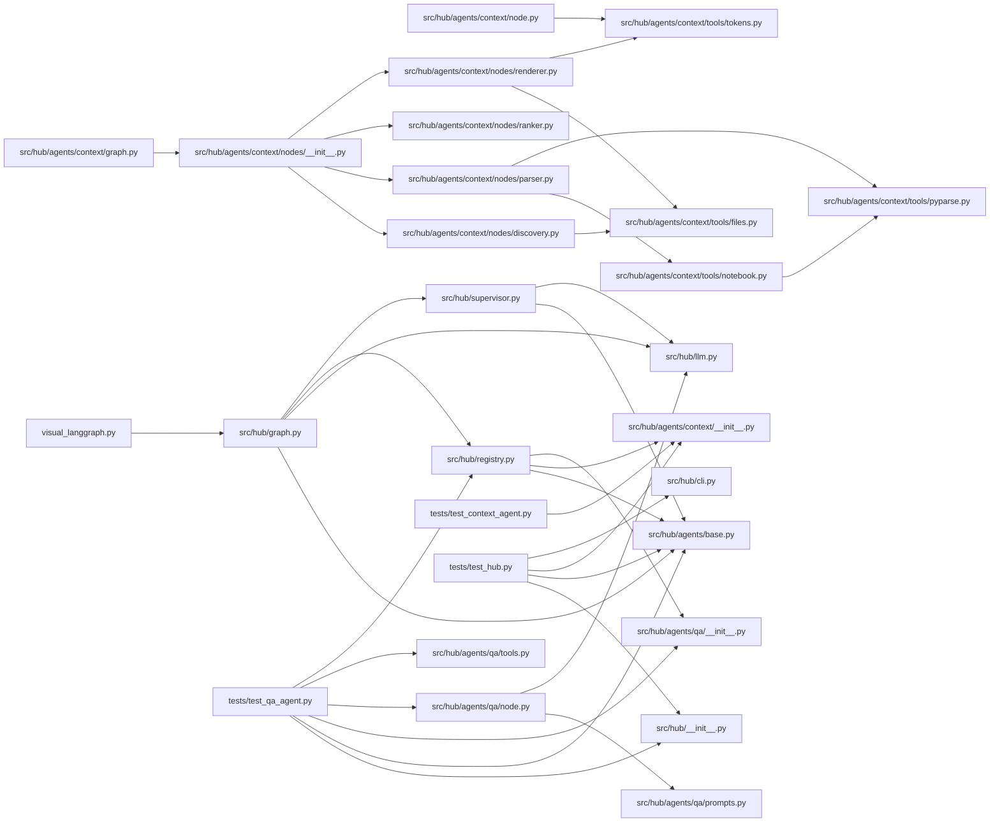

# Project context: agent-hub
> Root: `D:\Trietdeptrai\agent-hub`
> repo-context · mode=full · files=35 · full_code=35 · commit=078d78f
> Reading guide: `[SKELETON]` = signatures + first docstring line only (`# L12` = line number; `c3:L5` = notebook cell 3, line 5). `[FULL]` = complete code with comments stripped. If you need the body of a skeleton file, ask the user for it by path.
> ~13,214 tokens

## 1. Overview
### Stack
- Declared dependencies: langchain-core, langchain-google-genai, langgraph, python-dotenv
- Third-party imports seen in code: dotenv, langchain_core, langchain_google_genai, langgraph, pydantic, tiktoken

### Entry points
- `src/hub/agents/context/cli.py`
- `src/hub/cli.py`

### Structure
```text
├── src/
│   └── hub/
│       ├── agents/
│       │   ├── context/
│       │   │   ├── nodes/
│       │   │   │   ├── __init__.py
│       │   │   │   ├── base.py
│       │   │   │   ├── discovery.py
│       │   │   │   ├── parser.py
│       │   │   │   ├── ranker.py
│       │   │   │   └── renderer.py
│       │   │   ├── tools/
│       │   │   │   ├── __init__.py
│       │   │   │   ├── files.py
│       │   │   │   ├── notebook.py
│       │   │   │   ├── pyparse.py
│       │   │   │   └── tokens.py
│       │   │   ├── __init__.py
│       │   │   ├── cli.py
│       │   │   ├── config.py
│       │   │   ├── graph.py
│       │   │   ├── node.py
│       │   │   └── state.py
│       │   ├── qa/
│       │   │   ├── __init__.py
│       │   │   ├── node.py
│       │   │   ├── prompts.py
│       │   │   └── tools.py
│       │   ├── __init__.py
│       │   └── base.py
│       ├── __init__.py
│       ├── cli.py
│       ├── config.py
│       ├── graph.py
│       ├── llm.py
│       ├── registry.py
│       ├── state.py
│       └── supervisor.py
├── tests/
│   ├── test_context_agent.py
│   ├── test_hub.py
│   └── test_qa_agent.py
├── README.md
├── pyproject.toml
└── visual_langgraph.py
```

### Internal imports


## 2. Files

### src/hub/agents/base.py  [FULL]
```python
"""Agent contract.

An agent = AgentSpec(name, description, node)
  - name:        unique id, used as the graph node name
  - description: ONE clear sentence; the supervisor reads it to decide when to route here
  - node:        (HubState) -> dict, normally {"messages": [AIMessage(...)]}

Inside, an agent can be anything: plain code (like `context`), a LangChain agent, or its own LangGraph
subgraph. Use `langgraph.types.interrupt(...)` in a node when it needs to ask the user something.
"""
from dataclasses import dataclass
from typing import Callable

@dataclass(frozen=True)
class AgentSpec:
    name: str
    description: str
    node: Callable[[dict], dict]
```

### src/hub/agents/context/__init__.py  [FULL]
```python
from ..base import AgentSpec
from .graph import build_context
from .node import context_node
SPEC = AgentSpec(name='context', description='Đọc một dự án/repo code và tạo file ngữ cảnh gọn (cây thư mục, skeleton, code chính) để đưa cho chatbot khác hiểu dự án nhanh. Không dùng LLM.', node=context_node)
__all__ = ['SPEC', 'build_context']
```

### src/hub/llm.py  [FULL]
```python
"""One place that creates the LLM, so swapping provider/model later touches only this file."""
import os
from .config import MODEL, TEMPERATURE

def get_llm():
    api_key = os.getenv('GOOGLE_API_KEY') or os.getenv('GEMINI_API_KEY')
    if not api_key:
        raise RuntimeError('Chưa có GOOGLE_API_KEY hoặc GEMINI_API_KEY.')
    from langchain_google_genai import ChatGoogleGenerativeAI
    return ChatGoogleGenerativeAI(model=MODEL, temperature=TEMPERATURE, google_api_key=api_key, api_version='v1beta')
```

### src/hub/cli.py  [FULL]
```python
"""Chat loop. Handles agent questions (interrupts) transparently."""
from langchain_core.messages import HumanMessage
from langgraph.types import Command
from .graph import build_hub

def run_turn(app, text: str, config: dict, ask=input, say=print) -> str:
    result = app.invoke({'messages': [HumanMessage(text)]}, config)
    while '__interrupt__' in result:
        say(result['__interrupt__'][0].value)
        result = app.invoke(Command(resume=ask('> ')), config)
    return result['messages'][-1].content

def main():
    app = build_hub()
    config = {'configurable': {'thread_id': 'cli'}}
    print("Agent hub. Gõ 'exit' để thoát. Ví dụ: 'tạo context cho dự án ./my_repo'")
    while True:
        try:
            text = input('bạn> ').strip()
        except (EOFError, KeyboardInterrupt):
            break
        if text.lower() in {'exit', 'quit', ''}:
            if text:
                break
            continue
        print(run_turn(app, text, config))
if __name__ == '__main__':
    main()
```

### src/hub/__init__.py  [FULL]
```python
from .graph import build_hub
__all__ = ['build_hub']
```

### src/hub/agents/context/tools/files.py  [FULL]
```python
"""File discovery and directory tree rendering."""
import subprocess
from fnmatch import fnmatch
from pathlib import Path
from ..config import CODE_EXT, IGNORE_DIRS, MANIFESTS

def _git_files(root: Path) -> list[str] | None:
    try:
        r = subprocess.run(['git', '-C', str(root), 'ls-files', '--cached', '--others', '--exclude-standard'], capture_output=True, text=True, check=True)
        return [l for l in r.stdout.splitlines() if l]
    except Exception:
        return None

def _walk(root: Path) -> list[str]:
    out = []
    for p in root.rglob('*'):
        if p.is_file():
            out.append(p.relative_to(root).as_posix())
    return out

def discover(root: str, exclude: list[str] | tuple=()) -> tuple[list[str], list[str]]:
    """Return (code_files, manifest_files) as sorted posix paths relative to root."""
    r = Path(root)
    code, manifests = ([], [])
    for p in sorted(_git_files(r) or _walk(r)):
        pp = Path(p)
        if any((part in IGNORE_DIRS for part in pp.parts)):
            continue
        if any((fnmatch(p, pat) for pat in exclude)):
            continue
        if pp.suffix in CODE_EXT:
            code.append(p)
        elif pp.name in MANIFESTS:
            manifests.append(p)
    return (code, manifests)

def git_head(root: str) -> str | None:
    try:
        r = subprocess.run(['git', '-C', root, 'rev-parse', '--short', 'HEAD'], capture_output=True, text=True, check=True)
        return r.stdout.strip() or None
    except Exception:
        return None

def render_tree(paths: list[str]) -> str:
    tree: dict = {}
    for p in paths:
        node = tree
        for part in Path(p).parts:
            node = node.setdefault(part, {})
    lines: list[str] = []

    def walk(node: dict, prefix: str=''):
        items = sorted(node.items(), key=lambda kv: (not kv[1], kv[0]))
        for i, (name, child) in enumerate(items):
            last = i == len(items) - 1
            lines.append(f"{prefix}{('└── ' if last else '├── ')}{name}{('/' if child else '')}")
            if child:
                walk(child, prefix + ('    ' if last else '│   '))
    walk(tree)
    return '\n'.join(lines)
```

### src/hub/agents/context/tools/pyparse.py  [FULL]
```python
"""Python source -> skeleton / imports / cleaned full code, using the stdlib `ast`."""
import ast
import copy
from typing import TypedDict
import warnings

class Parsed(TypedDict):
    skeleton: list[str]
    clean: str
    imports: list[str]
    has_main: bool

def _sig(node) -> str:
    c = copy.copy(node)
    c.body = [ast.Pass()]
    c.decorator_list = []
    return ast.unparse(c).splitlines()[0].rstrip(':')

def _doc(node) -> str | None:
    d = ast.get_docstring(node)
    return d.strip().splitlines()[0] if d and d.strip() else None

def _is_main_guard(node: ast.AST) -> bool:
    return isinstance(node, ast.If) and isinstance(node.test, ast.Compare) and isinstance(node.test.left, ast.Name) and (node.test.left.id == '__name__')

def _walk_defs(body, indent: int, loc: str, out: list[str]):
    pad = '  ' * indent
    for n in body:
        if isinstance(n, (ast.FunctionDef, ast.AsyncFunctionDef, ast.ClassDef)):
            for d in n.decorator_list:
                out.append(f'{pad}@{ast.unparse(d)}')
            head = _sig(n) if not isinstance(n, ast.ClassDef) else f'class {n.name}' + (f"({', '.join((ast.unparse(b) for b in n.bases))})" if n.bases else '')
            out.append(f'{pad}{head}  # {loc}{n.lineno}')
            if (d := _doc(n)):
                out.append(f'{pad}  """{d}"""')
            if isinstance(n, ast.ClassDef):
                _walk_defs(n.body, indent + 1, loc, out)
        elif indent == 0 and isinstance(n, ast.Assign):
            for t in n.targets:
                if isinstance(t, ast.Name) and t.id.isupper():
                    val = ast.unparse(n.value)
                    out.append(f"{t.id} = {val[:60]}{('...' if len(val) > 60 else '')}  # {loc}{n.lineno}")

def analyze(source: str, loc: str='L') -> Parsed:
    """`loc` is the location prefix, e.g. "L" for files or "c3:L" for notebook cell 3."""
    try:
        with warnings.catch_warnings():
            warnings.simplefilter('ignore', SyntaxWarning)
            tree = ast.parse(source)
    except SyntaxError:
        clean = '\n'.join((l for l in source.splitlines() if l.strip()))
        return {'skeleton': [f'# (syntax error, raw lines kept)'], 'clean': clean, 'imports': [], 'has_main': False}
    imports, skel = ([], [])
    for n in ast.walk(tree):
        if isinstance(n, ast.Import):
            imports += [a.name for a in n.names]
        elif isinstance(n, ast.ImportFrom) and n.level == 0 and n.module:
            imports.append(n.module)
            imports += [f'{n.module}.{a.name}' for a in n.names]
        elif isinstance(n, ast.ImportFrom) and n.level > 0:
            base = '.' * n.level + (n.module or '')
            imports.append(base)
            imports += [f'{base}.{a.name}' if n.module else f'{base}{a.name}' for a in n.names]
    _walk_defs(tree.body, 0, loc, skel)
    return {'skeleton': skel, 'clean': ast.unparse(tree), 'imports': imports, 'has_main': any((_is_main_guard(n) for n in tree.body))}
```

### src/hub/agents/context/tools/tokens.py  [FULL]
```python
"""Token counting: tiktoken if usable, else chars/4 estimate (tiktoken needs network on first use)."""
_enc = None
_tried = False

def count_tokens(text: str) -> int:
    global _enc, _tried
    if not _tried:
        _tried = True
        try:
            import tiktoken
            _enc = tiktoken.get_encoding('cl100k_base')
        except Exception:
            _enc = None
    if _enc is not None:
        return len(_enc.encode(text, disallowed_special=()))
    return max(1, len(text) // 4)
```

### src/hub/agents/qa/__init__.py  [FULL]
```python
from ..base import AgentSpec
from .node import qa_node
SPEC = AgentSpec(name='qa', description='Trả lời câu hỏi về code/dự án dựa trên PROJECT_CONTEXT.md (dùng Gemini). Hỏi về hàm, class, luồng xử lý, kiến trúc... của dự án đã tạo context.', node=qa_node)
__all__ = ['SPEC']
```

### src/hub/registry.py  [FULL]
```python
"""THE place to register agents. To add one: create hub/agents/<name>/ exposing SPEC, import it, append."""
from .agents.base import AgentSpec
from .agents.context import SPEC as context_spec
from .agents.qa import SPEC as qa_spec
AGENTS: list[AgentSpec] = [context_spec, qa_spec]
```

### src/hub/agents/context/cli.py  [FULL]
```python
import argparse
import sys
from .config import DEFAULT_MODE, MODES
from .graph import build_context
MENU = 'Chọn mức ngữ cảnh:\n  1. map       Bản đồ nhanh (cây thư mục + skeleton)\n  2. balanced  Cân bằng (bản đồ + full code vài file chính)   [mặc định]\n  3. full      Đầy đủ (toàn bộ code, đã bỏ comment/output notebook)'

def _ask_mode() -> str:
    print(MENU)
    choice = input('Chọn [2]: ').strip() or '2'
    return {'1': 'map', '2': 'balanced', '3': 'full'}.get(choice, DEFAULT_MODE)

def main(argv=None):
    ap = argparse.ArgumentParser(prog='repo-context', description=__doc__)
    ap.add_argument('root', nargs='?', default='.')
    ap.add_argument('--mode', choices=list(MODES), help='bỏ qua menu nếu đã chọn')
    ap.add_argument('--budget', type=int, help='token budget cho full code (ghi đè mode)')
    ap.add_argument('--pin', action='append', default=[], help='luôn gửi full code file này')
    ap.add_argument('--exclude', action='append', default=[], help="glob loại file, vd 'tests/*'")
    ap.add_argument('-o', '--output', default='PROJECT_CONTEXT.md', help="'-' để in ra stdout")
    a = ap.parse_args(argv)
    mode = a.mode or (_ask_mode() if sys.stdin.isatty() else DEFAULT_MODE)
    text = build_context(a.root, mode, budget=a.budget if a.budget is not None else ..., pin=a.pin, exclude=a.exclude)
    if a.output == '-':
        print(text)
    else:
        with open(a.output, 'w', encoding='utf-8') as f:
            f.write(text)
        print(f'Wrote {a.output}', file=sys.stderr)
if __name__ == '__main__':
    main()
```

### src/hub/agents/context/nodes/__init__.py  [FULL]
```python
"""Context-pipeline nodes. To add a node: write `nodes/my_node.py` with `my_node(state) -> dict`,
import it here, and put it in PIPELINE where it should run. Nothing else changes."""
from .base import AgentNode
from .discovery import discovery_node
from .parser import parser_node
from .ranker import ranker_node
from .renderer import renderer_node
PIPELINE: list[tuple[str, AgentNode]] = [('discovery', discovery_node), ('parser', parser_node), ('ranker', ranker_node), ('renderer', renderer_node)]
```

### src/hub/agents/context/nodes/discovery.py  [FULL]
```python
from ..state import State
from ..tools.files import discover

def discovery_node(state: State) -> dict:
    files, manifests = discover(state['root'], state.get('exclude', []))
    return {'files': files, 'manifests': manifests}
```

### src/hub/agents/context/nodes/parser.py  [FULL]
```python
from pathlib import Path
from ..state import ModuleInfo, State
from ..tools.notebook import analyze_notebook
from ..tools.pyparse import analyze

def parser_node(state: State) -> dict:
    root = Path(state['root'])
    parsed: dict[str, ModuleInfo] = {}
    for f in state['files']:
        raw = (root / f).read_text(encoding='utf-8', errors='replace')
        if f.endswith('.ipynb'):
            a, kind = (analyze_notebook(raw), 'ipynb')
            skeleton = '\n'.join(a['skeleton'])
        else:
            a, kind = (analyze(raw), 'py')
            skeleton = '\n'.join(a['skeleton'])
        parsed[f] = {'kind': kind, 'skeleton': skeleton, 'clean': a['clean'], 'imports': a['imports'], 'has_main': a['has_main']}
    return {'parsed': parsed}
```

### src/hub/agents/context/nodes/ranker.py  [FULL]
```python
"""Builds the import graph and scores files. Higher score = more likely to deserve full code."""
from pathlib import PurePosixPath
from ..config import CORE_HINTS, ENTRY_NAMES, LOW_HINTS
from ..state import State

def _module_names(path: str) -> set[str]:
    p = PurePosixPath(path)
    parts = list(p.with_suffix('').parts)
    if parts and parts[-1] == '__init__':
        parts = parts[:-1]
    return {'.'.join(parts[i:]) for i in range(len(parts))} if parts else set()

def ranker_node(state: State) -> dict:
    parsed = state['parsed']
    index: dict[str, set[str]] = {}
    for f in parsed:
        for name in _module_names(f):
            index.setdefault(name, set()).add(f)
    edges: set[tuple[str, str]] = set()
    for f, info in parsed.items():
        for imp in info['imports']:
            name = imp.lstrip('.')
            for cand in (name, name.rsplit('.', 1)[0] if '.' in name else name):
                targets = index.get(cand, set())
                if len(targets) == 1:
                    t = next(iter(targets))
                    if t != f:
                        edges.add((f, t))
                    break
    in_deg = {f: 0 for f in parsed}
    for _, t in edges:
        in_deg[t] += 1
    entry_points, scores = ([], {})
    for f, info in parsed.items():
        name = PurePosixPath(f).name.lower()
        score = in_deg[f] * 2.0
        if info['has_main'] or name in ENTRY_NAMES:
            score += 3
            entry_points.append(f)
        if any((h in name for h in CORE_HINTS)):
            score += 1.5
        if any((h in f.lower() for h in LOW_HINTS)):
            score -= 4
        scores[f] = score
    ranking = sorted(parsed, key=lambda f: (-scores[f], f))
    return {'edges': sorted(edges), 'ranking': ranking, 'entry_points': sorted(entry_points)}
```

### src/hub/agents/context/nodes/renderer.py  [FULL]
```python
"""Assembles the final markdown: overview (always) + per-file skeleton, upgraded to full code within budget."""
import re
import sys
import tomllib
from pathlib import Path
from ..state import State
from ..tools.files import git_head, render_tree
from ..tools.tokens import count_tokens

def _manifest_deps(root: Path, manifests: list[str]) -> list[str]:
    deps: list[str] = []
    for m in manifests:
        p = root / m
        try:
            if p.name == 'requirements.txt':
                for l in p.read_text().splitlines():
                    l = l.split('#')[0].strip()
                    if l and (not l.startswith('-')):
                        deps.append(re.split('[=<>~!\\[; ]', l)[0])
            elif p.name == 'pyproject.toml':
                data = tomllib.loads(p.read_text())
                for d in data.get('project', {}).get('dependencies', []):
                    deps.append(re.split('[=<>~!\\[; ]', d)[0])
        except Exception:
            pass
    return sorted(set(deps))

def _third_party(parsed: dict, files: list[str]) -> list[str]:
    local = {Path(f).with_suffix('').parts[-1] for f in files} | {p for f in files for p in Path(f).parts[:-1]}
    std = set(sys.stdlib_module_names)
    out = set()
    for info in parsed.values():
        for imp in info['imports']:
            if imp.startswith('.'):
                continue
            top = imp.split('.')[0]
            if top not in std and top not in local:
                out.add(top)
    return sorted(out)

def _mermaid(edges: list[tuple[str, str]], limit: int=40) -> str:
    nid = lambda p: re.sub('\\W', '_', p)
    lines = ['graph LR']
    for a, b in edges[:limit]:
        lines.append(f'  {nid(a)}["{a}"] --> {nid(b)}["{b}"]')
    if len(edges) > limit:
        lines.append(f'  %% +{len(edges) - limit} more edges omitted')
    return '\n'.join(lines)

def renderer_node(state: State) -> dict:
    root = Path(state['root']).resolve()
    parsed, files = (state['parsed'], state['files'])
    budget, pins = (state.get('budget'), set(state.get('pin', [])))
    full: list[str] = []
    remaining = budget if budget is not None else 0
    order = [f for f in state['ranking'] if f in pins] + [f for f in state['ranking'] if f not in pins]
    for f in order:
        cost = count_tokens(parsed[f]['clean'])
        if budget is None or f in pins or (remaining > 0 and cost <= remaining):
            full.append(f)
            remaining = max(0, remaining - cost)
    deps = _manifest_deps(root, state.get('manifests', []))
    tp = _third_party(parsed, files)
    parts = ['## 1. Overview', '### Stack']
    parts.append(f"- Declared dependencies: {(', '.join(deps) if deps else '(none found)')}")
    parts.append(f"- Third-party imports seen in code: {(', '.join(tp) if tp else '(none)')}")
    parts += ['', '### Entry points']
    parts += [f'- `{f}`' for f in state['entry_points']] or ['- (none detected)']
    parts += ['', '### Structure', '```text', render_tree(files + state.get('manifests', [])), '```']
    if state['edges']:
        parts += ['', '### Internal imports', '```mermaid', _mermaid(state['edges']), '```']
    parts += ['', '## 2. Files']
    for f in state['ranking']:
        info = parsed[f]
        if f in full:
            lang = 'python'
            parts += ['', f'### {f}  [FULL]', f'```{lang}', info['clean'], '```']
        else:
            body = info['skeleton'] or '# (no top-level definitions)'
            parts += ['', f'### {f}  [SKELETON]', '```text', body, '```']
    body = '\n'.join(parts)
    head = ['# Project context: ' + root.name, f'> Root: `{root}`']
    sha = git_head(str(root))
    meta = [f"mode={state.get('mode')}", f'files={len(files)}', f'full_code={len(full)}']
    if sha:
        meta.append(f'commit={sha}')
    head.append('> repo-context · ' + ' · '.join(meta))
    head.append('> Reading guide: `[SKELETON]` = signatures + first docstring line only (`# L12` = line number; `c3:L5` = notebook cell 3, line 5). `[FULL]` = complete code with comments stripped. If you need the body of a skeleton file, ask the user for it by path.')
    out = '\n'.join(head) + '\n\n' + body + '\n'
    out = out.replace('\n\n## 1.', f'\n> ~{count_tokens(out):,} tokens\n\n## 1.', 1)
    return {'output': out}
```

### src/hub/agents/context/tools/notebook.py  [FULL]
```python
"""Jupyter notebook -> same shape as a .py module. Outputs are always dropped (they cost many tokens)."""
import json
from .pyparse import analyze

def _strip_magics(code: str) -> str:
    return '\n'.join((l for l in code.splitlines() if not l.lstrip().startswith(('%', '!'))))

def analyze_notebook(raw: str) -> dict:
    try:
        cells = json.loads(raw).get('cells', [])
    except Exception:
        return {'skeleton': ['# (unreadable notebook)'], 'clean': '', 'imports': [], 'has_main': False}
    skel, clean, imports, has_main = ([], [], [], False)
    for i, c in enumerate(cells):
        src = ''.join(c.get('source', []))
        if not src.strip():
            continue
        if c.get('cell_type') == 'markdown':
            text = '\n'.join((f'> {l}' for l in src.strip().splitlines()))
            skel.append(f'[md cell {i}]\n{text}')
            clean.append(f'# [md cell {i}]\n' + '\n'.join((f'# {l}' for l in src.strip().splitlines())))
        elif c.get('cell_type') == 'code':
            a = analyze(_strip_magics(src), loc=f'c{i}:L')
            if a['skeleton']:
                skel.append(f'[code cell {i}]')
                skel += a['skeleton']
            clean.append(f"# [code cell {i}]\n{a['clean']}")
            imports += a['imports']
            has_main = has_main or a['has_main']
    return {'skeleton': skel, 'clean': '\n\n'.join(clean), 'imports': imports, 'has_main': has_main}
```

### src/hub/agents/qa/node.py  [FULL]
```python
"""QA agent node – answers questions about a project using PROJECT_CONTEXT.md + Gemini.

Flow:
1. Load the latest PROJECT_CONTEXT.md (written by the context agent).
2. Send the question + context to Gemini.
3. If Gemini says it needs more code (JSON {"need_file": ...}), fetch that file/function
   from disk and retry ONCE with the extra code appended.
4. Return the final answer as an AIMessage with file:line citations.
"""
import json
import re
from pathlib import Path
from langchain_core.messages import AIMessage, HumanMessage, SystemMessage
from langgraph.types import interrupt
from ...llm import get_llm
from .prompts import SYSTEM_PROMPT, CONTEXT_HEADER, EXTRA_CODE_HEADER, NEED_MORE_CODE_INSTRUCTION
from .tools import read_file_content, read_function, find_project_root_from_context
CONTEXT_FILE = 'PROJECT_CONTEXT.md'
MAX_RETRIES = 2

def _last_user_text(state) -> str:
    for m in reversed(state.get('messages', [])):
        if getattr(m, 'type', '') == 'human':
            return m.content if isinstance(m.content, str) else str(m.content)
    return ''

def _load_context() -> str | None:
    """Load the most recent PROJECT_CONTEXT.md."""
    p = Path(CONTEXT_FILE)
    if p.is_file():
        return p.read_text(encoding='utf-8', errors='ignore')
    for f in sorted(Path('.').glob('**/PROJECT_CONTEXT*.md'), key=lambda x: x.stat().st_mtime, reverse=True):
        return f.read_text(encoding='utf-8', errors='ignore')
    return None

def _parse_need_file(response_text: str) -> dict | None:
    """Check if the LLM response is a JSON request for more code."""
    text = response_text.strip()
    json_match = re.search('```json\\s*(\\{.*?\\})\\s*```', text, re.DOTALL)
    if json_match:
        text = json_match.group(1)
    elif not text.startswith('{'):
        return None
    try:
        data = json.loads(text)
        if 'need_file' in data:
            return data
    except (json.JSONDecodeError, TypeError):
        pass
    return None

def qa_node(state) -> dict:
    """Main QA node: reads context, asks Gemini, fetches extra code if needed."""
    question = _last_user_text(state)
    context_text = _load_context()
    if context_text is None:
        return {'messages': [AIMessage('⚠️ Chưa có PROJECT_CONTEXT.md. Hãy tạo context trước bằng lệnh:\n`tạo context cho dự án <đường_dẫn>`\n\nSau đó hỏi lại câu hỏi của bạn.')]}
    project_root = find_project_root_from_context(context_text)
    llm = get_llm()
    system_msg = SystemMessage(content=SYSTEM_PROMPT)
    context_msg = HumanMessage(content=CONTEXT_HEADER.format(context=context_text) + '\n' + NEED_MORE_CODE_INSTRUCTION)
    question_msg = HumanMessage(content=f'Câu hỏi: {question}')
    messages = [system_msg, context_msg, question_msg]
    extra_context_parts: list[str] = []
    for attempt in range(MAX_RETRIES + 1):
        response = llm.invoke(messages)
        answer = response.content if isinstance(response.content, str) else str(response.content)
        need = _parse_need_file(answer)
        if need is None or project_root is None:
            break
        rel_path = need['need_file']
        func_name = need.get('function')
        if func_name:
            extra = read_function(project_root, rel_path, func_name)
            label = f'{rel_path}::{func_name}'
        else:
            extra = read_file_content(project_root, rel_path)
            label = rel_path
        if extra is None:
            messages.append(AIMessage(content=answer))
            messages.append(HumanMessage(content=f'File `{label}` không tìm thấy. Hãy trả lời với thông tin hiện có.'))
            continue
        extra_block = EXTRA_CODE_HEADER.format(path=label, code=extra)
        extra_context_parts.append(extra_block)
        messages.append(AIMessage(content=answer))
        messages.append(HumanMessage(content=extra_block + '\nBây giờ hãy trả lời câu hỏi gốc với thông tin bổ sung.'))
    if _parse_need_file(answer):
        answer = 'Không thể lấy thêm code để trả lời đầy đủ. Dựa trên context hiện có:\n\n' + answer
    sources = '📄 Nguồn: `PROJECT_CONTEXT.md`'
    if extra_context_parts:
        sources += ' + code bổ sung'
    final = f'{answer}\n\n---\n{sources}'
    return {'messages': [AIMessage(content=final)]}
```

### src/hub/agents/qa/prompts.py  [FULL]
```python
"""Prompts for the QA agent.  Kept separate so they're easy to tweak."""
SYSTEM_PROMPT = 'Bạn là trợ lý phân tích code.  Bạn được cung cấp PROJECT_CONTEXT.md — bản tóm tắt cấu trúc\nvà skeleton của một dự án.  Nhiệm vụ: trả lời câu hỏi của người dùng về dự án đó.\n\nQUY TẮC:\n1. Trả lời bằng tiếng Việt, ngắn gọn, chính xác.\n2. Luôn trích dẫn vị trí: `file_path:dòng` (hoặc khoảng dòng) khi nói về code cụ thể.\n3. Nếu thông tin trong context CHƯA ĐỦ để trả lời, hãy nói rõ bạn cần xem thêm file nào\n   bằng cách trả về JSON tool-call (xem bên dưới).  KHÔNG bịa code.\n4. Sau khi có thêm code, trả lời câu hỏi gốc kèm trích dẫn file:dòng.\n5. Dùng markdown formatting cho code blocks.\n'
CONTEXT_HEADER = '--- PROJECT CONTEXT (tóm tắt dự án) ---\n{context}\n--- HẾT CONTEXT ---\n'
EXTRA_CODE_HEADER = '--- CODE BỔ SUNG: {path} ---\n```\n{code}\n```\n--- HẾT CODE BỔ SUNG ---\n'
NEED_MORE_CODE_INSTRUCTION = 'Nếu context ở trên chưa đủ để trả lời, hãy trả lời chính xác theo format JSON sau\n(KHÔNG thêm gì khác ngoài JSON):\n{"need_file": "<relative_path_to_file>"}\n\nNếu cần xem một hàm cụ thể:\n{"need_file": "<relative_path>", "function": "<function_name>"}\n\nNếu ĐỦ thông tin, trả lời bình thường bằng markdown.\n'
```

### src/hub/agents/qa/tools.py  [FULL]
```python
"""Helpers for the QA agent: read specific files or functions from a project on disk."""
import ast
import re
from pathlib import Path

def read_file_content(project_root: str, rel_path: str, max_lines: int=500) -> str | None:
    """Read a file from the project.  Returns at most *max_lines* lines, or None if not found."""
    fp = Path(project_root) / rel_path
    if not fp.is_file():
        return None
    try:
        lines = fp.read_text(encoding='utf-8', errors='ignore').splitlines()
        numbered = [f'L{i + 1}: {line}' for i, line in enumerate(lines[:max_lines])]
        if len(lines) > max_lines:
            numbered.append(f'... ({len(lines) - max_lines} dòng bị cắt)')
        return '\n'.join(numbered)
    except Exception as e:
        return f'# Lỗi đọc file: {e}'

def read_function(project_root: str, rel_path: str, func_name: str) -> str | None:
    """Extract a single function/method from a Python file, with line numbers."""
    fp = Path(project_root) / rel_path
    if not fp.is_file():
        return None
    try:
        source = fp.read_text(encoding='utf-8', errors='ignore')
        tree = ast.parse(source)
    except Exception:
        return None
    lines = source.splitlines()
    for node in ast.walk(tree):
        if isinstance(node, (ast.FunctionDef, ast.AsyncFunctionDef)) and node.name == func_name:
            start = node.lineno - 1
            end = node.end_lineno or start + 1
            snippet = lines[start:end]
            numbered = [f'L{start + i + 1}: {line}' for i, line in enumerate(snippet)]
            return '\n'.join(numbered)
    return None

def find_project_root_from_context(context_text: str) -> str | None:
    """Try to extract the project root path from a PROJECT_CONTEXT.md header.

    The renderer writes a line like:  > Root: `D:\\path\\to\\project`
    """
    m = re.search('^>\\s*Root:\\s*`?([^`\\n]+)`?', context_text, re.M)
    if m:
        p = Path(m.group(1).strip())
        if p.is_dir():
            return str(p)
    m = re.search('(?:Project|Root|Path|Dự án)[:\\s]+[`\\"\']?([A-Za-z]:\\\\[^\\s`\\"\']+|/[^\\s`\\"\']+)', context_text, re.I)
    if m:
        p = Path(m.group(1))
        if p.is_dir():
            return str(p)
    m = re.search('^#\\s+(?:Project context:\\s*)?(.+)', context_text, re.M)
    if m:
        name = m.group(1).strip().strip('`')
        for parent in [Path('.')]:
            candidate = parent / name
            if candidate.is_dir():
                return str(candidate.resolve())
    return None
```

### src/hub/graph.py  [FULL]
```python
"""Builds the hub graph from the registry:  START -> supervisor -> <chosen agent> -> END.
(To let agents hand off to each other later, add edges agent -> supervisor and a FINISH route.)"""
from langgraph.checkpoint.memory import MemorySaver
from langgraph.graph import END, START, StateGraph
from .agents.base import AgentSpec
from .llm import get_llm
from .registry import AGENTS
from .state import HubState
from .supervisor import make_supervisor

def build_hub(agents: list[AgentSpec] | None=None, llm_factory=get_llm, checkpointer=None):
    agents = agents or AGENTS
    g = StateGraph(HubState)
    g.add_node('supervisor', make_supervisor(agents, llm_factory))
    g.add_edge(START, 'supervisor')
    for a in agents:
        g.add_node(a.name, a.node)
        g.add_edge(a.name, END)
    g.add_conditional_edges('supervisor', lambda s: s['next'], {a.name: a.name for a in agents})
    return g.compile(checkpointer=checkpointer or MemorySaver())
```

### src/hub/supervisor.py  [FULL]
```python
"""Supervisor: picks which agent handles the latest user message.

Free-tier friendly: with a single registered agent it makes NO LLM call; with several it makes one
small structured-output call per user message (only the last message is sent, never the whole history).
"""
from pydantic import BaseModel, Field
from .agents.base import AgentSpec
from .llm import get_llm
PROMPT = 'Bạn là bộ điều phối. Chọn đúng MỘT agent phù hợp nhất để xử lý yêu cầu của người dùng.\n\nCác agent:\n{catalog}\n\nYêu cầu của người dùng:\n{request}\n\nTrả về tên agent. Nếu không agent nào phù hợp, chọn "{default}".'

class Route(BaseModel):
    agent: str = Field(description='Tên agent được chọn')

def _last_user_text(state) -> str:
    for m in reversed(state.get('messages', [])):
        if getattr(m, 'type', '') == 'human':
            return m.content if isinstance(m.content, str) else str(m.content)
    return ''

def make_supervisor(agents: list[AgentSpec], llm_factory=get_llm):
    names = [a.name for a in agents]
    catalog = '\n'.join((f'- {a.name}: {a.description}' for a in agents))

    def supervisor(state) -> dict:
        if len(agents) == 1:
            return {'next': names[0]}
        prompt = PROMPT.format(catalog=catalog, request=_last_user_text(state), default=names[0])
        route = llm_factory().with_structured_output(Route).invoke(prompt)
        return {'next': route.agent if route.agent in names else names[0]}
    return supervisor
```

### src/hub/agents/context/config.py  [FULL]
```python
"""Constants and mode presets. Token budget for full code: 0 = off, None = unlimited."""
MODES = {'map': 0, 'balanced': 8000, 'full': None}
DEFAULT_MODE = 'balanced'
IGNORE_DIRS = {'.git', '__pycache__', '.venv', 'venv', 'env', 'node_modules', '.ipynb_checkpoints', '.mypy_cache', '.pytest_cache', 'build', 'dist', '.idea', '.vscode', 'site-packages'}
CODE_EXT = {'.py', '.ipynb'}
MANIFESTS = {'README.md', 'requirements.txt', 'pyproject.toml', 'Dockerfile', 'environment.yml'}
ENTRY_NAMES = {'main.py', 'train.py', 'app.py', 'run.py', 'cli.py', '__main__.py'}
CORE_HINTS = ('model', 'config', 'core', 'dataset', 'data')
LOW_HINTS = ('test_', '_test', 'setup.py', 'conftest', 'migrations')
```

### src/hub/config.py  [FULL]
```python
"""Hub settings. Free Gemini key: https://aistudio.google.com/apikey  ->  export GOOGLE_API_KEY=..."""
import os
from dotenv import find_dotenv, load_dotenv
load_dotenv(find_dotenv(usecwd=True))
load_dotenv()
MODEL = os.getenv('HUB_MODEL', 'gemini-2.5-flash')
TEMPERATURE = 0.0
```

### src/hub/agents/__init__.py  [FULL]
```python
"""One sub-package per agent. Each exposes a `SPEC` (see base.py); register it in hub/registry.py."""
```

### src/hub/agents/context/graph.py  [FULL]
```python
"""Builds the LangGraph from the agent registry. v1 is a linear chain; for branching/conditional
edges later, replace the loop below with explicit add_edge / add_conditional_edges calls."""
from langgraph.graph import END, START, StateGraph
from .nodes import PIPELINE
from .config import DEFAULT_MODE, MODES
from .state import State

def build_graph():
    g = StateGraph(State)
    prev = START
    for name, node in PIPELINE:
        g.add_node(name, node)
        g.add_edge(prev, name)
        prev = name
    g.add_edge(prev, END)
    return g.compile()

def build_context(root: str, mode: str=DEFAULT_MODE, budget: int | None=..., pin=(), exclude=()) -> str:
    """Single entry point: used by the CLI now, and can be wrapped as a tool/MCP endpoint later."""
    if mode not in MODES:
        raise ValueError(f'mode must be one of {list(MODES)}')
    if budget is ...:
        budget = MODES[mode]
    result = build_graph().invoke({'root': root, 'mode': mode, 'budget': budget, 'pin': list(pin), 'exclude': list(exclude)})
    return result['output']
```

### src/hub/agents/context/node.py  [FULL]
```python
"""Hub-facing wrapper of the context agent: parse the request, ask the fixed menu if needed, run, reply."""
import re
from pathlib import Path
from langchain_core.messages import AIMessage
from langgraph.types import interrupt
from .graph import build_context
from .tools.tokens import count_tokens
MENU = 'Bạn muốn mức ngữ cảnh nào?\n  1. map       Bản đồ nhanh (cây thư mục + skeleton)\n  2. balanced  Cân bằng (bản đồ + full code vài file chính)\n  3. full      Đầy đủ (toàn bộ code, đã bỏ comment/output notebook)\nNhập 1/2/3 (mặc định 2):'
_MODE_KEYWORDS = {'map': ('map', 'tổng quan', 'bản đồ', 'skeleton'), 'full': ('full', 'đầy đủ', 'toàn bộ'), 'balanced': ('balanced', 'cân bằng')}
OUTPUT_FILE = 'PROJECT_CONTEXT.md'

def _last_user_text(state) -> str:
    for m in reversed(state.get('messages', [])):
        if getattr(m, 'type', '') == 'human':
            return m.content if isinstance(m.content, str) else str(m.content)
    return ''

def _find_dir(text: str) -> str | None:
    for tok in re.findall('[\\w./~\\\\:-]+', text):
        cleaned = tok.rstrip(',:;')
        if cleaned and Path(cleaned).expanduser().is_dir():
            return str(Path(cleaned).expanduser().resolve())
    return None

def _find_mode(text: str) -> str | None:
    low = text.lower()
    for mode, kws in _MODE_KEYWORDS.items():
        if any((re.search(f'\\b{re.escape(k)}\\b', low) for k in kws)):
            return mode
    return None
CANCEL = {'0', 'q', 'exit', 'huỷ', 'huy', 'cancel'}

def context_node(state) -> dict:
    text = _last_user_text(state)
    root = _find_dir(text)
    if root is None:
        ans = str(interrupt('Dự án nằm ở đâu? Nhập đường dẫn thư mục (gõ . cho thư mục hiện tại, 0 để huỷ):')).strip().strip('"')
        if ans.lower() in CANCEL:
            return {'messages': [AIMessage('Đã huỷ, không tạo file.')]}
        if not Path(ans).expanduser().is_dir():
            return {'messages': [AIMessage(f'Không tìm thấy thư mục: {ans}')]}
        root = str(Path(ans).expanduser())
    mode = _find_mode(text)
    if mode is None:
        choice = str(interrupt(MENU)).strip().lower()
        if choice in CANCEL:
            return {'messages': [AIMessage('Đã huỷ, không tạo file.')]}
        mode = {'1': 'map', '2': 'balanced', '3': 'full'}.get(choice, choice if choice in _MODE_KEYWORDS else 'balanced')
    out = build_context(root, mode)
    Path(OUTPUT_FILE).write_text(out, encoding='utf-8')
    msg = f'Đã tạo `{OUTPUT_FILE}` từ `{Path(root).resolve()}` (mode={mode}, ~{count_tokens(out):,} token). Bạn đưa file này cho chatbot khác là dùng được.'
    return {'messages': [AIMessage(msg)]}
```

### src/hub/agents/context/nodes/base.py  [FULL]
```python
"""Node contract (inside the context agent).

An agent is just a function `(State) -> dict`: read what you need from the state and return
ONLY the keys you produce. LangGraph merges that into the shared state.

Deterministic agents (v1) are plain functions. Later, an LLM agent is the same thing, e.g.:

    from langchain.chat_models import init_chat_model
    llm = init_chat_model("claude-sonnet-4-5")

    def summarizer_node(state: State) -> dict:
        ...  # call llm / a langchain agent, return {"summaries": {...}}
"""
from typing import Callable
from ..state import State
AgentNode = Callable[[State], dict]
```

### src/hub/agents/context/state.py  [FULL]
```python
"""Shared graph state. Every agent reads from it and returns a PARTIAL dict to merge in."""
from typing import TypedDict

class ModuleInfo(TypedDict):
    kind: str
    skeleton: str
    clean: str
    imports: list[str]
    has_main: bool

class State(TypedDict, total=False):
    root: str
    mode: str
    budget: int | None
    pin: list[str]
    exclude: list[str]
    files: list[str]
    manifests: list[str]
    parsed: dict[str, ModuleInfo]
    edges: list[tuple[str, str]]
    ranking: list[str]
    entry_points: list[str]
    output: str
```

### src/hub/agents/context/tools/__init__.py  [FULL]
```python
"""Pure, deterministic helpers. No graph/state knowledge here, so they are easy to test and reuse."""
```

### src/hub/state.py  [FULL]
```python
"""State of the top-level hub graph. Agents read `messages` and append their reply to it."""
from typing import Annotated, TypedDict
from langchain_core.messages import AnyMessage
from langgraph.graph.message import add_messages

class HubState(TypedDict, total=False):
    messages: Annotated[list[AnyMessage], add_messages]
    next: str
```

### visual_langgraph.py  [FULL]
```python
from hub.graph import build_hub
from pathlib import Path
app = build_hub()
png_data = app.get_graph().draw_mermaid_png()
Path('hub_graph.png').write_bytes(png_data)
print('Saved graph to hub_graph.png')
```

### tests/test_context_agent.py  [FULL]
```python
import json
from hub.agents.context import build_context

def _make_project(tmp_path):
    (tmp_path / 'model.py').write_text('import torch\n\nclass CNN:\n    """Simple CNN."""\n    def __init__(self, n: int = 3):\n        # a comment\n        self.n = n\n\nLR = 0.001\n')
    (tmp_path / 'train.py').write_text('from model import CNN\n\ndef fit(m: CNN, epochs: int = 10) -> list[float]:\n    """Train."""\n    return []\n\nif __name__ == "__main__":\n    fit(CNN())\n')
    nb = {'cells': [{'cell_type': 'markdown', 'source': ['# Demo']}, {'cell_type': 'code', 'source': ['!pip install x\n', 'import model\n', 'def f(x): return x\n'], 'outputs': [{'text': 'HUGE OUTPUT'}]}]}
    (tmp_path / 'demo.ipynb').write_text(json.dumps(nb))
    (tmp_path / 'requirements.txt').write_text('torch>=2\n')

def test_map_mode(tmp_path):
    _make_project(tmp_path)
    out = build_context(str(tmp_path), 'map')
    assert '  [SKELETON]' in out and '  [FULL]' not in out
    assert 'class CNN  # L3' in out and 'LR = 0.001' in out
    assert 'a comment' not in out and 'HUGE OUTPUT' not in out
    assert 'train.py' in out.split('### Entry points')[1].split('###')[0]
    assert 'train_py --> model_py' in out.replace('["train.py"]', '').replace('["model.py"]', '')

def test_full_and_pin(tmp_path):
    _make_project(tmp_path)
    assert out_full(tmp_path, 'full').count('  [FULL]') == 3
    out = build_context(str(tmp_path), 'map', pin=['model.py'])
    assert '### model.py  [FULL]' in out and '### train.py  [SKELETON]' in out

def out_full(tmp_path, mode):
    return build_context(str(tmp_path), mode)
```

### tests/test_hub.py  [FULL]
```python
from langchain_core.messages import AIMessage, HumanMessage
from langgraph.types import Command
from hub import build_hub
from hub.agents.base import AgentSpec
from hub.agents.context import SPEC as context_spec
from hub.cli import run_turn

class FakeLLM:
    """Stands in for Gemini: routes by keyword and counts calls."""
    calls = 0

    def with_structured_output(self, schema):
        outer = self

        class _R:

            def invoke(self, prompt):
                outer.calls += 1
                req = prompt.split('Yêu cầu của người dùng:')[1]
                return schema(agent='echo' if 'echo' in req else 'context')
        return _R()

def _echo(state):
    return {'messages': [AIMessage('echo-agent reply')]}

def test_single_agent_no_llm_call_and_menu(tmp_path, monkeypatch):
    (tmp_path / 'a.py').write_text('def f():\n    return 1\n')
    monkeypatch.chdir(tmp_path)
    app = build_hub([context_spec], llm_factory=lambda: (_ for _ in ()).throw(AssertionError('LLM called')))
    cfg = {'configurable': {'thread_id': 't'}}
    said = []
    reply = run_turn(app, 'tạo context cho dự án .', cfg, ask=lambda _: '1', say=said.append)
    assert 'Nhập 1/2/3' in said[0]
    assert 'mode=map' in reply
    assert 'def f()' in (tmp_path / 'PROJECT_CONTEXT.md').read_text()

def test_mode_keyword_skips_menu(tmp_path, monkeypatch):
    (tmp_path / 'a.py').write_text('x = 1\n')
    monkeypatch.chdir(tmp_path)
    app = build_hub([context_spec])
    cfg = {'configurable': {'thread_id': 't2'}}
    result = app.invoke({'messages': [HumanMessage('context full cho .')]}, cfg)
    assert '__interrupt__' not in result and 'mode=full' in result['messages'][-1].content

def test_adding_second_agent_routes_by_llm(tmp_path, monkeypatch):
    monkeypatch.chdir(tmp_path)
    echo = AgentSpec('echo', 'Lặp lại lời người dùng', _echo)
    llm = FakeLLM()
    app = build_hub([context_spec, echo], llm_factory=lambda: llm)
    out = app.invoke({'messages': [HumanMessage('hãy echo giúp tôi')]}, {'configurable': {'thread_id': 't3'}})
    assert out['messages'][-1].content == 'echo-agent reply' and llm.calls == 1
```

### tests/test_qa_agent.py  [FULL]
```python
"""Tests for the QA agent."""
import json
from pathlib import Path
from unittest.mock import MagicMock, patch
from langchain_core.messages import AIMessage, HumanMessage
from hub import build_hub
from hub.agents.base import AgentSpec
from hub.agents.qa import SPEC as qa_spec
from hub.agents.qa.node import qa_node, _load_context, _parse_need_file
from hub.agents.qa.tools import read_file_content, read_function

def test_parse_need_file_valid_json():
    assert _parse_need_file('{"need_file": "src/model.py"}') == {'need_file': 'src/model.py'}

def test_parse_need_file_with_function():
    text = '{"need_file": "src/model.py", "function": "train"}'
    result = _parse_need_file(text)
    assert result == {'need_file': 'src/model.py', 'function': 'train'}

def test_parse_need_file_wrapped_in_code_block():
    text = '```json\n{"need_file": "utils.py"}\n```'
    result = _parse_need_file(text)
    assert result == {'need_file': 'utils.py'}

def test_parse_need_file_normal_answer():
    text = 'Hàm `train()` nằm ở file `model.py:45`.'
    assert _parse_need_file(text) is None

def test_read_file_content(tmp_path):
    f = tmp_path / 'hello.py'
    f.write_text("def hello():\n    print('hi')\n", encoding='utf-8')
    content = read_file_content(str(tmp_path), 'hello.py')
    assert 'L1: def hello():' in content
    assert 'L2:' in content

def test_read_file_content_not_found(tmp_path):
    assert read_file_content(str(tmp_path), 'nope.py') is None

def test_read_function(tmp_path):
    code = 'import os\n\ndef foo():\n    """Do foo."""\n    return 1\n\ndef bar(x, y):\n    return x + y\n\nclass MyClass:\n    def method(self):\n        pass\n'
    (tmp_path / 'example.py').write_text(code, encoding='utf-8')
    result = read_function(str(tmp_path), 'example.py', 'bar')
    assert result is not None
    assert 'def bar(x, y):' in result
    assert 'return x + y' in result

def test_read_function_not_found(tmp_path):
    (tmp_path / 'example.py').write_text('def foo(): pass\n', encoding='utf-8')
    assert read_function(str(tmp_path), 'example.py', 'nope') is None

def test_qa_node_no_context(tmp_path, monkeypatch):
    """QA agent should say 'chưa có context' when no PROJECT_CONTEXT.md exists."""
    monkeypatch.chdir(tmp_path)
    state = {'messages': [HumanMessage('hàm nào xử lý GAF?')]}
    result = qa_node(state)
    msg = result['messages'][0].content
    assert 'Chưa có PROJECT_CONTEXT.md' in msg

def test_qa_node_with_context_answers(tmp_path, monkeypatch):
    """QA agent should call LLM and return an answer when context exists."""
    monkeypatch.chdir(tmp_path)
    context = '# PROJECT CONTEXT: MyProject\n## Structure\n├── model.py\n## Skeleton\ndef train(): ...\n'
    (tmp_path / 'PROJECT_CONTEXT.md').write_text(context, encoding='utf-8')
    mock_response = MagicMock()
    mock_response.content = 'Hàm `train()` nằm ở `model.py:L1` dùng để huấn luyện model.'
    mock_llm = MagicMock()
    mock_llm.invoke.return_value = mock_response
    with patch('hub.agents.qa.node.get_llm', return_value=mock_llm):
        state = {'messages': [HumanMessage('hàm nào để train model?')]}
        result = qa_node(state)
    msg = result['messages'][0].content
    assert 'train()' in msg
    assert 'PROJECT_CONTEXT.md' in msg

def test_qa_node_fetches_extra_code(tmp_path, monkeypatch):
    """QA agent should fetch extra code when LLM requests it."""
    monkeypatch.chdir(tmp_path)
    context = f'# PROJECT CONTEXT: TestProj\nRoot: {tmp_path}\n## Files\n├── math_utils.py\n'
    (tmp_path / 'PROJECT_CONTEXT.md').write_text(context, encoding='utf-8')
    (tmp_path / 'math_utils.py').write_text('def add(a, b):\n    return a + b\n', encoding='utf-8')
    need_response = MagicMock()
    need_response.content = '{"need_file": "math_utils.py"}'
    answer_response = MagicMock()
    answer_response.content = 'Hàm `add(a, b)` ở `math_utils.py:L1` cộng hai số.'
    mock_llm = MagicMock()
    mock_llm.invoke.side_effect = [need_response, answer_response]
    with patch('hub.agents.qa.node.get_llm', return_value=mock_llm):
        state = {'messages': [HumanMessage('hàm nào cộng hai số?')]}
        result = qa_node(state)
    msg = result['messages'][0].content
    assert 'add(a, b)' in msg
    assert mock_llm.invoke.call_count == 2
    assert 'code bổ sung' in msg

def test_qa_spec_registered():
    """QA agent should be in the global registry."""
    from hub.registry import AGENTS
    names = [a.name for a in AGENTS]
    assert 'qa' in names
    assert 'context' in names
```
