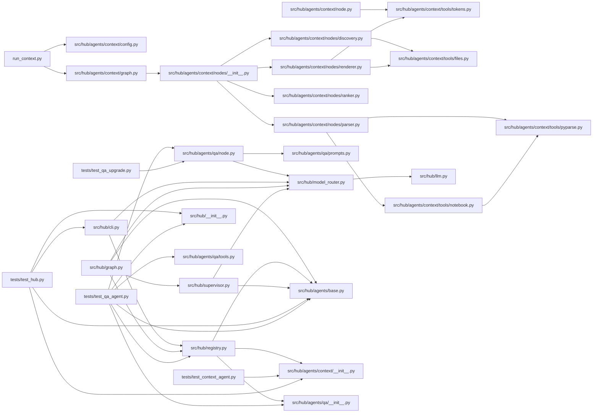

# Project context: agent-hub
> Root: `D:\Trietdeptrai\agent-hub`
> repo-context · mode=full · files=38 · full_code=38 · commit=239a330
> Reading guide: `[SKELETON]` = signatures + first docstring line only (`# L12` = line number; `c3:L5` = notebook cell 3, line 5). `[FULL]` = complete code with comments stripped. If you need the body of a skeleton file, ask the user for it by path.
> ~23,446 tokens

## 1. Overview
### Stack
- Declared dependencies: langchain-core, langchain-google-genai, langgraph, python-dotenv
- Third-party imports seen in code: dotenv, langchain_core, langchain_google_genai, langgraph, pydantic, tiktoken

### Entry points
- `run_context.py`
- `src/hub/agents/context/cli.py`
- `src/hub/cli.py`

### Structure
```text
├── src/
│   └── hub/
│       ├── agents/
│       │   ├── context/
│       │   │   ├── nodes/
│       │   │   │   ├── __init__.py
│       │   │   │   ├── base.py
│       │   │   │   ├── discovery.py
│       │   │   │   ├── parser.py
│       │   │   │   ├── ranker.py
│       │   │   │   └── renderer.py
│       │   │   ├── tools/
│       │   │   │   ├── __init__.py
│       │   │   │   ├── files.py
│       │   │   │   ├── notebook.py
│       │   │   │   ├── pyparse.py
│       │   │   │   └── tokens.py
│       │   │   ├── __init__.py
│       │   │   ├── cli.py
│       │   │   ├── config.py
│       │   │   ├── graph.py
│       │   │   ├── node.py
│       │   │   └── state.py
│       │   ├── qa/
│       │   │   ├── __init__.py
│       │   │   ├── node.py
│       │   │   ├── prompts.py
│       │   │   └── tools.py
│       │   ├── __init__.py
│       │   └── base.py
│       ├── __init__.py
│       ├── cli.py
│       ├── config.py
│       ├── graph.py
│       ├── llm.py
│       ├── model_router.py
│       ├── registry.py
│       ├── state.py
│       └── supervisor.py
├── tests/
│   ├── test_context_agent.py
│   ├── test_hub.py
│   ├── test_qa_agent.py
│   └── test_qa_upgrade.py
├── README.md
├── pyproject.toml
├── run_context.py
└── visual_langgraph.py
```

### Internal imports


## 2. Files

### src/hub/agents/base.py  [FULL]
```python
"""Agent contract.

An agent = AgentSpec(name, description, node)
  - name:        unique id, used as the graph node name
  - description: ONE clear sentence; the supervisor reads it to decide when to route here
  - node:        (HubState) -> dict, normally {"messages": [AIMessage(...)]}

Inside, an agent can be anything: plain code (like `context`), a LangChain agent, or its own LangGraph
subgraph. Use `langgraph.types.interrupt(...)` in a node when it needs to ask the user something.
"""
from dataclasses import dataclass
from typing import Callable

@dataclass(frozen=True)
class AgentSpec:
    name: str
    description: str
    node: Callable[[dict], dict]
```

### src/hub/model_router.py  [FULL]
```python
"""LLM Router with automatic model failover + usage tracking."""
import logging
import time
from dataclasses import dataclass, field
from functools import lru_cache
from .llm import get_llm_models
logger = logging.getLogger(__name__)
COOLDOWN_SECONDS = 3600

def is_retryable_error(error: Exception) -> bool:
    message = str(error).lower()
    patterns = ['429', 'resource_exhausted', 'rate_limit', 'quota exceeded', '500', '502', '503', '504', 'service unavailable', 'timeout']
    return any((pattern in message for pattern in patterns))

def _reason(error: Exception) -> str:
    message = str(error).lower()
    if any((k in message for k in ('429', 'resource_exhausted', 'rate_limit', 'quota'))):
        return 'hết quota/rate limit'
    return 'lỗi tạm thời'

@dataclass
class UsageTracker:
    """Đếm request theo model + ghi lại model nào đã trả lời trong lượt chat hiện tại.

    Lưu ý: Gemini API không trả về quota còn lại, nên đây chỉ là số request *đã gọi thành công*
    trong phiên chạy này, dùng để ước lượng.
    """
    calls: dict[str, int] = field(default_factory=dict)
    failures: dict[str, int] = field(default_factory=dict)
    cooldowns: dict[str, float] = field(default_factory=dict)
    turn_models: list[str] = field(default_factory=list)
    route_models: list[str] = field(default_factory=list)
    turn_events: list[str] = field(default_factory=list)

    def begin_turn(self):
        self.turn_models, self.route_models, self.turn_events = ([], [], [])

    def mark_routing(self):
        """Supervisor gọi sau khi route xong: các model đã dùng tới giờ là để điều phối, không phải để trả lời."""
        self.route_models, self.turn_models = (self.turn_models, [])

    def cooldown_left(self, model: str) -> int:
        return max(0, int(self.cooldowns.get(model, 0) - time.time()))

    def is_cooling(self, model: str) -> bool:
        return self.cooldown_left(model) > 0

    def success(self, model: str):
        self.calls[model] = self.calls.get(model, 0) + 1
        if model not in self.turn_models:
            self.turn_models.append(model)

    def failure(self, model: str, error: Exception):
        self.failures[model] = self.failures.get(model, 0) + 1
        self.cooldowns[model] = time.time() + COOLDOWN_SECONDS
        self.turn_events.append(f'{model}: {_reason(error)} → chuyển model kế tiếp')

    def next_model(self, pool: list[str]) -> str | None:
        return next((m for m in pool if not self.is_cooling(m)), None)
TRACKER = UsageTracker()

class ModelRouter:

    def __init__(self, models, tracker: UsageTracker | None=None):
        self.models = models
        self.tracker = tracker or TRACKER

    def _invoke(self, input_data, structured_schema=None, **kwargs):
        errors = []
        for model in self.models:
            model_name = model.model
            if self.tracker.is_cooling(model_name):
                continue
            try:
                logger.info('Trying model: %s', model_name)
                runnable = model.with_structured_output(structured_schema) if structured_schema else model
                result = runnable.invoke(input_data, **kwargs)
                logger.info('Model succeeded: %s', model_name)
                self.tracker.success(model_name)
                return result
            except Exception as error:
                if not is_retryable_error(error):
                    raise
                logger.warning('Model %s failed: %s', model_name, error)
                self.tracker.failure(model_name, error)
                errors.append(error)
        if errors:
            raise RuntimeError('Tất cả model trong MODEL_POOL đều không khả dụng.') from errors[-1]
        raise RuntimeError('Không còn model khả dụng trong MODEL_POOL.')

    def invoke(self, input_data, **kwargs):
        return self._invoke(input_data, **kwargs)

    def with_structured_output(self, schema, **kwargs):
        return StructuredOutputRouter(self, schema, kwargs)

class StructuredOutputRouter:

    def __init__(self, router, schema, config):
        self.router = router
        self.schema = schema
        self.config = config

    def invoke(self, input_data, **kwargs):
        return self.router._invoke(input_data, structured_schema=self.schema, **self.config, **kwargs)

@lru_cache(maxsize=1)
def get_model_router():
    """Return one shared ModelRouter."""
    return ModelRouter(get_llm_models())

def get_llm():
    """Return the shared ModelRouter."""
    return get_model_router()
```

### src/hub/agents/context/__init__.py  [FULL]
```python
from ..base import AgentSpec
from .graph import build_context
from .node import context_node
SPEC = AgentSpec(name='context', description='Project Context Agent: Chuyên đọc và phân tích source code của một dự án. Quét cấu trúc thư mục, xác định các module quan trọng, đọc code và tạo file PROJECT_CONTEXT.md chứa cây thư mục, kiến trúc, chức năng các module và luồng xử lý chính. Sử dụng khi người dùng muốn tạo, xây dựng lại hoặc cập nhật context cho một repository/dự án để chatbot có thể hiểu codebase. Không sử dụng LLM.', node=context_node)
__all__ = ['SPEC', 'build_context']
```

### src/hub/registry.py  [FULL]
```python
"""THE place to register agents. To add one: create hub/agents/<name>/ exposing SPEC, import it, append."""
from .agents.base import AgentSpec
from .agents.context import SPEC as context_spec
from .agents.qa import SPEC as qa_spec
AGENTS: list[AgentSpec] = [context_spec, qa_spec]
```

### src/hub/cli.py  [FULL]
```python
"""Chat loop. Handles agent questions (interrupts) transparently.

Chọn agent thẳng:  /qa <câu hỏi>   /context <yêu cầu>   -> bỏ qua bước LLM điều phối (đỡ tốn request).
Lệnh:              /help  /agents  /models  /reset
"""
from langchain_core.messages import HumanMessage
from langgraph.types import Command
from .config import MODEL_POOL
from .graph import build_hub
from .model_router import TRACKER
from .registry import AGENTS

def parse_route(text: str, names: list[str]) -> tuple[str | None, str]:
    """'/qa hàm nào train?' -> ('qa', 'hàm nào train?'). Không có prefix agent hợp lệ -> (None, text)."""
    if not text.startswith('/'):
        return (None, text)
    head, _, rest = text[1:].partition(' ')
    if head.lower() in names:
        return (head.lower(), rest.strip())
    return (None, text)

def _turn(app, text: str, config: dict, ask, say, forced: str | None) -> tuple[str, str | None]:
    result = app.invoke({'messages': [HumanMessage(text)], 'forced': forced}, config)
    while '__interrupt__' in result:
        say(result['__interrupt__'][0].value)
        result = app.invoke(Command(resume=ask('> ')), config)
    return (result['messages'][-1].content, result.get('next'))

def run_turn(app, text: str, config: dict, ask=input, say=print, forced: str | None=None) -> str:
    return _turn(app, text, config, ask, say, forced)[0]

def help_text() -> str:
    lines = ['Chọn agent thẳng (không tốn request điều phối):']
    for a in AGENTS:
        lines.append(f"  /{a.name} <nội dung>   {a.description.split(':')[0]}")
    lines += ['Không có prefix -> LLM tự chọn agent (tốn 1 request nhỏ).', 'Lệnh: /models (xem quota ước lượng) · /reset (xoá trí nhớ hội thoại) · /help · exit']
    return '\n'.join(lines)

def models_report() -> str:
    nxt = TRACKER.next_model(MODEL_POOL)
    lines = ['Model pool (ưu tiên từ trên xuống, ▶ = model sẽ được gọi tiếp theo):']
    for m in MODEL_POOL:
        left = TRACKER.cooldown_left(m)
        status = f'   ✗ đang nghỉ, còn ~{left // 60 + 1} phút' if left else ''
        lines.append(f"  {('▶' if m == nxt else ' ')} {m:<28}{TRACKER.calls.get(m, 0):>4} request{status}")
    lines.append('(Số request tính từ lúc mở chương trình; Gemini không trả quota còn lại.)')
    return '\n'.join(lines)

def _print_turn_notes():
    for ev in TRACKER.turn_events:
        print(f'  ⚠ {ev}')
    if TRACKER.route_models:
        print(f"  ↳ điều phối bằng {' → '.join(TRACKER.route_models)} (gõ /qa hoặc /context để bỏ bước này)")

def main():
    app = build_hub()
    names = [a.name for a in AGENTS]
    thread_no = 1
    config = {'configurable': {'thread_id': f'cli-{thread_no}'}}
    print("Agent hub. Gõ /help để xem lệnh, 'exit' để thoát. Ví dụ: '/context ./my_repo' hoặc '/qa hàm nào xử lý GAF?'")
    while True:
        try:
            text = input('bạn> ').strip()
        except (EOFError, KeyboardInterrupt):
            break
        if not text:
            continue
        if text.lower() in {'exit', 'quit'}:
            break
        cmd = text.split()[0].lower()
        if cmd in {'/help', '/agents'}:
            print(help_text())
            continue
        if cmd == '/models':
            print(models_report())
            continue
        if cmd == '/reset':
            thread_no += 1
            config = {'configurable': {'thread_id': f'cli-{thread_no}'}}
            print('Đã xoá trí nhớ hội thoại, bắt đầu cuộc trò chuyện mới.')
            continue
        forced, body = parse_route(text, names)
        if text.startswith('/') and forced is None:
            print(f'Không có lệnh/agent "{cmd}". Gõ /help.')
            continue
        if forced and (not body):
            print(f'Thêm nội dung sau /{forced}. Ví dụ: /{forced} ...')
            continue
        TRACKER.begin_turn()
        try:
            reply, agent = _turn(app, body, config, input, print, forced)
        except RuntimeError as e:
            _print_turn_notes()
            print(f'hub> ⚠ {e}  (gõ /models để xem trạng thái)')
            continue
        _print_turn_notes()
        label = ' → '.join(TRACKER.turn_models) or forced or agent or 'hub'
        print(f'{label}> {reply}')
if __name__ == '__main__':
    main()
```

### src/hub/__init__.py  [FULL]
```python
from .graph import build_hub
__all__ = ['build_hub']
```

### src/hub/agents/context/tools/files.py  [FULL]
```python
"""File discovery and directory tree rendering."""
import subprocess
from fnmatch import fnmatch
from pathlib import Path
from ..config import CODE_EXT, IGNORE_DIRS, MANIFESTS

def _git_files(root: Path) -> list[str] | None:
    try:
        r = subprocess.run(['git', '-C', str(root), 'ls-files', '--cached', '--others', '--exclude-standard'], capture_output=True, text=True, check=True)
        return [l for l in r.stdout.splitlines() if l]
    except Exception:
        return None

def _walk(root: Path) -> list[str]:
    out = []
    for p in root.rglob('*'):
        if p.is_file():
            out.append(p.relative_to(root).as_posix())
    return out

def discover(root: str, exclude: list[str] | tuple=()) -> tuple[list[str], list[str]]:
    """Return (code_files, manifest_files) as sorted posix paths relative to root."""
    r = Path(root)
    code, manifests = ([], [])
    for p in sorted(_git_files(r) or _walk(r)):
        pp = Path(p)
        if any((part in IGNORE_DIRS for part in pp.parts)):
            continue
        if any((fnmatch(p, pat) for pat in exclude)):
            continue
        if pp.suffix in CODE_EXT:
            code.append(p)
        elif pp.name in MANIFESTS:
            manifests.append(p)
    return (code, manifests)

def git_head(root: str) -> str | None:
    try:
        r = subprocess.run(['git', '-C', root, 'rev-parse', '--short', 'HEAD'], capture_output=True, text=True, check=True)
        return r.stdout.strip() or None
    except Exception:
        return None

def render_tree(paths: list[str]) -> str:
    tree: dict = {}
    for p in paths:
        node = tree
        for part in Path(p).parts:
            node = node.setdefault(part, {})
    lines: list[str] = []

    def walk(node: dict, prefix: str=''):
        items = sorted(node.items(), key=lambda kv: (not kv[1], kv[0]))
        for i, (name, child) in enumerate(items):
            last = i == len(items) - 1
            lines.append(f"{prefix}{('└── ' if last else '├── ')}{name}{('/' if child else '')}")
            if child:
                walk(child, prefix + ('    ' if last else '│   '))
    walk(tree)
    return '\n'.join(lines)
```

### src/hub/agents/context/tools/pyparse.py  [FULL]
```python
"""Python source -> skeleton / imports / cleaned full code, using the stdlib `ast`."""
import ast
import copy
from typing import TypedDict
import warnings

class Parsed(TypedDict):
    skeleton: list[str]
    clean: str
    imports: list[str]
    has_main: bool

def _sig(node) -> str:
    c = copy.copy(node)
    c.body = [ast.Pass()]
    c.decorator_list = []
    return ast.unparse(c).splitlines()[0].rstrip(':')

def _doc(node) -> str | None:
    d = ast.get_docstring(node)
    return d.strip().splitlines()[0] if d and d.strip() else None

def _is_main_guard(node: ast.AST) -> bool:
    return isinstance(node, ast.If) and isinstance(node.test, ast.Compare) and isinstance(node.test.left, ast.Name) and (node.test.left.id == '__name__')

def _walk_defs(body, indent: int, loc: str, out: list[str]):
    pad = '  ' * indent
    for n in body:
        if isinstance(n, (ast.FunctionDef, ast.AsyncFunctionDef, ast.ClassDef)):
            for d in n.decorator_list:
                out.append(f'{pad}@{ast.unparse(d)}')
            head = _sig(n) if not isinstance(n, ast.ClassDef) else f'class {n.name}' + (f"({', '.join((ast.unparse(b) for b in n.bases))})" if n.bases else '')
            out.append(f'{pad}{head}  # {loc}{n.lineno}')
            if (d := _doc(n)):
                out.append(f'{pad}  """{d}"""')
            if isinstance(n, ast.ClassDef):
                _walk_defs(n.body, indent + 1, loc, out)
        elif indent == 0 and isinstance(n, ast.Assign):
            for t in n.targets:
                if isinstance(t, ast.Name) and t.id.isupper():
                    val = ast.unparse(n.value)
                    out.append(f"{t.id} = {val[:60]}{('...' if len(val) > 60 else '')}  # {loc}{n.lineno}")

def analyze(source: str, loc: str='L') -> Parsed:
    """`loc` is the location prefix, e.g. "L" for files or "c3:L" for notebook cell 3."""
    try:
        with warnings.catch_warnings():
            warnings.simplefilter('ignore', SyntaxWarning)
            tree = ast.parse(source)
    except SyntaxError:
        clean = '\n'.join((l for l in source.splitlines() if l.strip()))
        return {'skeleton': [f'# (syntax error, raw lines kept)'], 'clean': clean, 'imports': [], 'has_main': False}
    imports, skel = ([], [])
    for n in ast.walk(tree):
        if isinstance(n, ast.Import):
            imports += [a.name for a in n.names]
        elif isinstance(n, ast.ImportFrom) and n.level == 0 and n.module:
            imports.append(n.module)
            imports += [f'{n.module}.{a.name}' for a in n.names]
        elif isinstance(n, ast.ImportFrom) and n.level > 0:
            base = '.' * n.level + (n.module or '')
            imports.append(base)
            imports += [f'{base}.{a.name}' if n.module else f'{base}{a.name}' for a in n.names]
    _walk_defs(tree.body, 0, loc, skel)
    return {'skeleton': skel, 'clean': ast.unparse(tree), 'imports': imports, 'has_main': any((_is_main_guard(n) for n in tree.body))}
```

### src/hub/agents/context/tools/tokens.py  [FULL]
```python
"""Token counting: tiktoken if usable, else chars/4 estimate (tiktoken needs network on first use)."""
_enc = None
_tried = False

def count_tokens(text: str) -> int:
    global _enc, _tried
    if not _tried:
        _tried = True
        try:
            import tiktoken
            _enc = tiktoken.get_encoding('cl100k_base')
        except Exception:
            _enc = None
    if _enc is not None:
        return len(_enc.encode(text, disallowed_special=()))
    return max(1, len(text) // 4)
```

### src/hub/agents/qa/__init__.py  [FULL]
```python
from ..base import AgentSpec
from .node import qa_node
SPEC = AgentSpec(name='qa', description='Project QA Agent: Chuyên trả lời câu hỏi và giải thích source code của dự án dựa trên file PROJECT_CONTEXT.md. Sử dụng Gemini để phân tích kiến trúc, class, function, module, luồng xử lý và mối quan hệ giữa các thành phần. Khi context chưa đủ thông tin, Agent có thể đọc thêm file source code hoặc function cụ thể để tìm câu trả lời chính xác hơn. Sử dụng khi người dùng đặt câu hỏi, muốn giải thích, phân tích hoặc tìm hiểu code trong một dự án đã có context.', node=qa_node)
__all__ = ['SPEC']
```

### src/hub/agents/qa/node.py  [FULL]
```python
"""QA agent node – answers questions about a project using PROJECT_CONTEXT*.md + Gemini.

Flow:
1. Pick the context file: a path given in the question > $HUB_CONTEXT_FILE > newest PROJECT_CONTEXT*.md in cwd > newest in subfolders.
2. Send context + the last few Q&A turns (memory) + the question to Gemini.
3. If Gemini says it needs more code (JSON {"need_file": ...}), fetch that file / line range / function
   from disk and ask again, at most MAX_EXTRA_READS times.
4. Return the final answer as an AIMessage (name='qa') with file:line citations and the context file actually used.
"""
import json
import os
import re
from pathlib import Path
from langchain_core.messages import AIMessage, HumanMessage, SystemMessage
from langgraph.types import interrupt
from ...model_router import get_llm
from .prompts import SYSTEM_PROMPT, CONTEXT_HEADER, EXTRA_CODE_HEADER, NEED_MORE_CODE_INSTRUCTION
from .tools import read_file_content, read_function, find_project_root_from_context
CONTEXT_FILE = 'PROJECT_CONTEXT.md'
QA_NAME = 'qa'
MAX_EXTRA_READS = int(os.getenv('HUB_QA_MAX_READS', '2'))
HISTORY_TURNS = int(os.getenv('HUB_QA_HISTORY_TURNS', '3'))
HISTORY_CHARS = 1500
_PATH_RE = re.compile('"([^"]+\\.md)"|\\\'([^\\\']+\\.md)\\\'|([A-Za-z]:[\\\\/][^"\\\'`\\n]*?\\.md)|(\\S+\\.md)', re.I)

def _content_to_text(content) -> str:
    """Chuyển LangChain message content thành văn bản thuần."""
    if isinstance(content, str):
        return content
    if isinstance(content, list):
        texts = []
        for block in content:
            if isinstance(block, str):
                texts.append(block)
            elif isinstance(block, dict) and block.get('type') == 'text':
                texts.append(block.get('text', ''))
        return '\n'.join((text for text in texts if text))
    return str(content)

def _last_user_text(state) -> str:
    for m in reversed(state.get('messages', [])):
        if getattr(m, 'type', '') == 'human':
            return m.content if isinstance(m.content, str) else str(m.content)
    return ''

def _clip(text: str, limit: int) -> str:
    return text if len(text) <= limit else text[:limit].rstrip() + ' …'

def _history(state, max_turns: int=HISTORY_TURNS) -> list:
    """Vài lượt hỏi–đáp QA gần nhất (không gồm câu hỏi hiện tại), bỏ dòng nguồn để đỡ tốn token."""
    msgs = list(state.get('messages', []))
    last = max((i for i, m in enumerate(msgs) if getattr(m, 'type', '') == 'human'), default=None)
    if last is None or max_turns <= 0:
        return []
    prev = msgs[:last]
    pairs = [(a, b) for a, b in zip(prev, prev[1:]) if getattr(a, 'type', '') == 'human' and getattr(b, 'type', '') == 'ai' and (getattr(b, 'name', None) == QA_NAME)]
    out: list = []
    for human, ai in pairs[-max_turns:]:
        q = _clip(_content_to_text(human.content), HISTORY_CHARS)
        a = _clip(_content_to_text(ai.content).split('\n\n---\n')[0], HISTORY_CHARS)
        out += [HumanMessage(content=f'Câu hỏi: {q}'), AIMessage(content=a)]
    return out

def _extract_md_path(text: str) -> tuple[str, str] | None:
    """Tìm đường dẫn file .md trong câu hỏi. Trả (chuỗi gốc trong câu, đường dẫn đã làm sạch).

    Chỉ coi là "chủ đích" khi là đường dẫn tuyệt đối / có dấu / \\ , hoặc file tồn tại (tránh nhầm 'README.md' nhắc cho vui).
    """
    for m in _PATH_RE.finditer(text):
        raw = next((g for g in m.groups() if g))
        cleaned = raw.strip().strip('.,;:)')
        p = Path(cleaned).expanduser()
        if p.is_absolute() or '/' in cleaned or '\\' in cleaned or p.is_file():
            return (raw, cleaned)
    return None

def _load_context_with_path() -> tuple[str, Path] | None:
    """$HUB_CONTEXT_FILE > PROJECT_CONTEXT*.md mới nhất ở thư mục hiện tại > mới nhất ở thư mục con."""
    env = os.getenv('HUB_CONTEXT_FILE')
    if env and Path(env).is_file():
        p = Path(env)
        return (p.read_text(encoding='utf-8', errors='ignore'), p)
    for pattern in ('PROJECT_CONTEXT*.md', '**/PROJECT_CONTEXT*.md'):
        files = sorted(Path('.').glob(pattern), key=lambda x: x.stat().st_mtime, reverse=True)
        if files:
            return (files[0].read_text(encoding='utf-8', errors='ignore'), files[0])
    return None

def _load_context() -> str | None:
    """Load the most recent PROJECT_CONTEXT*.md."""
    found = _load_context_with_path()
    return found[0] if found else None

def _parse_need_file(response_text: str) -> dict | None:
    """Check if the LLM response is a JSON request for more code."""
    text = response_text.strip()
    json_match = re.search('```json\\s*(\\{.*?\\})\\s*```', text, re.DOTALL)
    if json_match:
        text = json_match.group(1)
    elif not text.startswith('{'):
        return None
    try:
        data = json.loads(text)
        if 'need_file' in data:
            return data
    except (json.JSONDecodeError, TypeError):
        pass
    return None

def _as_int(value) -> int | None:
    try:
        return int(value) if value is not None else None
    except (TypeError, ValueError):
        return None

def qa_node(state) -> dict:
    """Main QA node: reads context, asks Gemini, fetches extra code if needed."""
    question = _last_user_text(state)
    context_text, context_path = (None, None)
    mentioned = _extract_md_path(question)
    if mentioned:
        raw, cleaned = mentioned
        p = Path(cleaned).expanduser()
        if p.is_file():
            context_text, context_path = (p.read_text(encoding='utf-8', errors='ignore'), p)
            question = question.replace(raw, '(file context đã được nạp sẵn)').strip()
        elif p.is_absolute() or '/' in cleaned or '\\' in cleaned:
            hint = '\nNếu file nằm trên Desktop, thử `...\\OneDrive\\Desktop\\...`.' if 'desktop' in cleaned.lower() else ''
            return {'messages': [AIMessage(f'⚠️ Không tìm thấy file: `{cleaned}`\nKiểm tra lại đường dẫn (Python không thấy file này).{hint}')]}
    if context_text is None:
        found = _load_context_with_path()
        if found:
            context_text, context_path = found
    if context_text is None:
        return {'messages': [AIMessage('⚠️ Chưa có PROJECT_CONTEXT.md (hoặc PROJECT_CONTEXT_map/balanced/full.md). Hãy tạo context trước bằng lệnh:\n`/context <đường_dẫn>`\n\nSau đó hỏi lại câu hỏi của bạn.')]}
    project_root = find_project_root_from_context(context_text)
    llm = get_llm()
    system_msg = SystemMessage(content=SYSTEM_PROMPT)
    context_msg = HumanMessage(content=CONTEXT_HEADER.format(context=context_text) + '\n' + NEED_MORE_CODE_INSTRUCTION)
    question_msg = HumanMessage(content=f'Câu hỏi: {question}')
    messages = [system_msg, context_msg, *_history(state), question_msg]
    extra_labels: list[str] = []
    reads = 0
    while True:
        response = llm.invoke(messages)
        answer = _content_to_text(response.content)
        need = _parse_need_file(answer)
        if need is None or project_root is None:
            break
        if reads >= MAX_EXTRA_READS:
            messages.append(AIMessage(content=answer))
            messages.append(HumanMessage(content='Đã hết lượt đọc thêm code. Hãy trả lời ngay với thông tin hiện có, KHÔNG trả JSON.'))
            response = llm.invoke(messages)
            answer = _content_to_text(response.content)
            break
        reads += 1
        rel_path = need['need_file']
        func_name = need.get('function')
        start, end = (_as_int(need.get('start')), _as_int(need.get('end')))
        if func_name:
            extra = read_function(project_root, rel_path, func_name)
            label = f'{rel_path}::{func_name}'
        else:
            extra = read_file_content(project_root, rel_path, start=start or 1, end=end)
            label = rel_path + (f':L{start or 1}-{end}' if end else f':L{start}-' if start else '')
        if extra is None:
            messages.append(AIMessage(content=answer))
            messages.append(HumanMessage(content=f'File `{label}` không tìm thấy (hoặc nằm ngoài thư mục dự án). Hãy trả lời với thông tin hiện có.'))
            continue
        extra_labels.append(label)
        extra_block = EXTRA_CODE_HEADER.format(path=label, code=extra)
        messages.append(AIMessage(content=answer))
        messages.append(HumanMessage(content=extra_block + '\nBây giờ hãy trả lời câu hỏi gốc với thông tin bổ sung.'))
    if _parse_need_file(answer):
        answer = 'Không thể lấy thêm code để trả lời đầy đủ. Dựa trên context hiện có:\n\n' + answer
    sources = f'📄 Nguồn: `{context_path}`'
    if extra_labels:
        sources += f" + code bổ sung ({', '.join(extra_labels)})"
    final = f'{answer}\n\n---\n{sources}'
    return {'messages': [AIMessage(content=final, name=QA_NAME)]}
```

### src/hub/agents/context/config.py  [FULL]
```python
"""Constants and mode presets. Token budget for full code: 0 = off, None = unlimited."""
MODES = {'map': 0, 'balanced': 8000, 'full': None}
DEFAULT_MODE = 'balanced'
OUTPUT_FILE_TEMPLATE = 'PROJECT_CONTEXT_{mode}.md'
IGNORE_DIRS = {'.git', '__pycache__', '.venv', 'venv', 'env', 'node_modules', '.ipynb_checkpoints', '.mypy_cache', '.pytest_cache', 'build', 'dist', '.idea', '.vscode', 'site-packages'}
CODE_EXT = {'.py', '.ipynb'}
MANIFESTS = {'README.md', 'requirements.txt', 'pyproject.toml', 'Dockerfile', 'environment.yml'}
ENTRY_NAMES = {'main.py', 'train.py', 'app.py', 'run.py', 'cli.py', '__main__.py'}
CORE_HINTS = ('model', 'config', 'core', 'dataset', 'data')
LOW_HINTS = ('test_', '_test', 'setup.py', 'conftest', 'migrations')

def output_filename(mode: str) -> str:
    """Tên file theo mức ngữ cảnh: map -> PROJECT_CONTEXT_map.md, balanced -> ..._balanced.md, full -> ..._full.md."""
    return OUTPUT_FILE_TEMPLATE.format(mode=mode)
```

### run_context.py  [FULL]
```python
from pathlib import Path
from hub.agents.context.config import output_filename
from hub.agents.context.graph import build_context
MENU = '\nChọn mức ngữ cảnh:\n  1. map       Bản đồ nhanh (cây thư mục + skeleton)\n  2. balanced  Cân bằng (bản đồ + full code vài file chính)\n  3. full      Đầy đủ (toàn bộ code, đã bỏ comment/output notebook)\n'

def main():
    print('=== PROJECT CONTEXT GENERATOR ===')
    root = input('Đường dẫn dự án [.] : ').strip() or '.'
    project_root = Path(root).resolve()
    if not project_root.is_dir():
        print(f'Không tìm thấy thư mục: {project_root}')
        return
    print(f'\nDự án: {project_root}')
    print(MENU)
    choice = input('Chọn [2]: ').strip() or '2'
    mode = {'1': 'map', '2': 'balanced', '3': 'full'}.get(choice)
    if mode is None:
        print('Lựa chọn không hợp lệ.')
        return
    print(f'\nĐang tạo context ({mode})...')
    context = build_context(root=str(project_root), mode=mode)
    output_path = project_root / output_filename(mode)
    output_path.write_text(context, encoding='utf-8')
    print('\nĐã tạo context thành công!')
    print(f'File: {output_path}')
    print(f'Dung lượng: {len(context):,} ký tự')
if __name__ == '__main__':
    main()
```

### src/hub/agents/context/cli.py  [FULL]
```python
import argparse
import sys
from .config import DEFAULT_MODE, MODES, output_filename
from .graph import build_context
MENU = 'Chọn mức ngữ cảnh:\n  1. map       Bản đồ nhanh (cây thư mục + skeleton)\n  2. balanced  Cân bằng (bản đồ + full code vài file chính)   [mặc định]\n  3. full      Đầy đủ (toàn bộ code, đã bỏ comment/output notebook)'

def _ask_mode() -> str:
    print(MENU)
    choice = input('Chọn [2]: ').strip() or '2'
    return {'1': 'map', '2': 'balanced', '3': 'full'}.get(choice, DEFAULT_MODE)

def main(argv=None):
    ap = argparse.ArgumentParser(prog='repo-context', description=__doc__)
    ap.add_argument('root', nargs='?', default='.')
    ap.add_argument('--mode', choices=list(MODES), help='bỏ qua menu nếu đã chọn')
    ap.add_argument('--budget', type=int, help='token budget cho full code (ghi đè mode)')
    ap.add_argument('--pin', action='append', default=[], help='luôn gửi full code file này')
    ap.add_argument('--exclude', action='append', default=[], help="glob loại file, vd 'tests/*'")
    ap.add_argument('-o', '--output', default=None, help="tên file xuất (mặc định PROJECT_CONTEXT_<mode>.md); '-' để in ra stdout")
    a = ap.parse_args(argv)
    mode = a.mode or (_ask_mode() if sys.stdin.isatty() else DEFAULT_MODE)
    text = build_context(a.root, mode, budget=a.budget if a.budget is not None else ..., pin=a.pin, exclude=a.exclude)
    out_path = a.output or output_filename(mode)
    if out_path == '-':
        print(text)
    else:
        with open(out_path, 'w', encoding='utf-8') as f:
            f.write(text)
        print(f'Wrote {out_path}', file=sys.stderr)
if __name__ == '__main__':
    main()
```

### src/hub/agents/context/graph.py  [FULL]
```python
"""Builds the LangGraph from the agent registry. v1 is a linear chain; for branching/conditional
edges later, replace the loop below with explicit add_edge / add_conditional_edges calls."""
from langgraph.graph import END, START, StateGraph
from .nodes import PIPELINE
from .config import DEFAULT_MODE, MODES
from .state import State

def build_graph():
    g = StateGraph(State)
    prev = START
    for name, node in PIPELINE:
        g.add_node(name, node)
        g.add_edge(prev, name)
        prev = name
    g.add_edge(prev, END)
    return g.compile()

def build_context(root: str, mode: str=DEFAULT_MODE, budget: int | None=..., pin=(), exclude=()) -> str:
    """Single entry point: used by the CLI now, and can be wrapped as a tool/MCP endpoint later."""
    if mode not in MODES:
        raise ValueError(f'mode must be one of {list(MODES)}')
    if budget is ...:
        budget = MODES[mode]
    result = build_graph().invoke({'root': root, 'mode': mode, 'budget': budget, 'pin': list(pin), 'exclude': list(exclude)})
    return result['output']
```

### src/hub/agents/context/nodes/__init__.py  [FULL]
```python
"""Context-pipeline nodes. To add a node: write `nodes/my_node.py` with `my_node(state) -> dict`,
import it here, and put it in PIPELINE where it should run. Nothing else changes."""
from .base import AgentNode
from .discovery import discovery_node
from .parser import parser_node
from .ranker import ranker_node
from .renderer import renderer_node
PIPELINE: list[tuple[str, AgentNode]] = [('discovery', discovery_node), ('parser', parser_node), ('ranker', ranker_node), ('renderer', renderer_node)]
```

### src/hub/agents/context/nodes/discovery.py  [FULL]
```python
from ..state import State
from ..tools.files import discover

def discovery_node(state: State) -> dict:
    files, manifests = discover(state['root'], state.get('exclude', []))
    return {'files': files, 'manifests': manifests}
```

### src/hub/agents/context/nodes/parser.py  [FULL]
```python
from pathlib import Path
from ..state import ModuleInfo, State
from ..tools.notebook import analyze_notebook
from ..tools.pyparse import analyze

def parser_node(state: State) -> dict:
    root = Path(state['root'])
    parsed: dict[str, ModuleInfo] = {}
    for f in state['files']:
        raw = (root / f).read_text(encoding='utf-8', errors='replace')
        if f.endswith('.ipynb'):
            a, kind = (analyze_notebook(raw), 'ipynb')
            skeleton = '\n'.join(a['skeleton'])
        else:
            a, kind = (analyze(raw), 'py')
            skeleton = '\n'.join(a['skeleton'])
        parsed[f] = {'kind': kind, 'skeleton': skeleton, 'clean': a['clean'], 'imports': a['imports'], 'has_main': a['has_main']}
    return {'parsed': parsed}
```

### src/hub/agents/context/nodes/ranker.py  [FULL]
```python
"""Builds the import graph and scores files. Higher score = more likely to deserve full code."""
from pathlib import PurePosixPath
from ..config import CORE_HINTS, ENTRY_NAMES, LOW_HINTS
from ..state import State

def _module_names(path: str) -> set[str]:
    p = PurePosixPath(path)
    parts = list(p.with_suffix('').parts)
    if parts and parts[-1] == '__init__':
        parts = parts[:-1]
    return {'.'.join(parts[i:]) for i in range(len(parts))} if parts else set()

def ranker_node(state: State) -> dict:
    parsed = state['parsed']
    index: dict[str, set[str]] = {}
    for f in parsed:
        for name in _module_names(f):
            index.setdefault(name, set()).add(f)
    edges: set[tuple[str, str]] = set()
    for f, info in parsed.items():
        for imp in info['imports']:
            name = imp.lstrip('.')
            for cand in (name, name.rsplit('.', 1)[0] if '.' in name else name):
                targets = index.get(cand, set())
                if len(targets) == 1:
                    t = next(iter(targets))
                    if t != f:
                        edges.add((f, t))
                    break
    in_deg = {f: 0 for f in parsed}
    for _, t in edges:
        in_deg[t] += 1
    entry_points, scores = ([], {})
    for f, info in parsed.items():
        name = PurePosixPath(f).name.lower()
        score = in_deg[f] * 2.0
        if info['has_main'] or name in ENTRY_NAMES:
            score += 3
            entry_points.append(f)
        if any((h in name for h in CORE_HINTS)):
            score += 1.5
        if any((h in f.lower() for h in LOW_HINTS)):
            score -= 4
        scores[f] = score
    ranking = sorted(parsed, key=lambda f: (-scores[f], f))
    return {'edges': sorted(edges), 'ranking': ranking, 'entry_points': sorted(entry_points)}
```

### src/hub/agents/context/nodes/renderer.py  [FULL]
```python
"""Assembles the final markdown: overview (always) + per-file skeleton, upgraded to full code within budget."""
import re
import sys
import tomllib
from pathlib import Path
from ..state import State
from ..tools.files import git_head, render_tree
from ..tools.tokens import count_tokens

def _manifest_deps(root: Path, manifests: list[str]) -> list[str]:
    deps: list[str] = []
    for m in manifests:
        p = root / m
        try:
            if p.name == 'requirements.txt':
                for l in p.read_text().splitlines():
                    l = l.split('#')[0].strip()
                    if l and (not l.startswith('-')):
                        deps.append(re.split('[=<>~!\\[; ]', l)[0])
            elif p.name == 'pyproject.toml':
                data = tomllib.loads(p.read_text())
                for d in data.get('project', {}).get('dependencies', []):
                    deps.append(re.split('[=<>~!\\[; ]', d)[0])
        except Exception:
            pass
    return sorted(set(deps))

def _third_party(parsed: dict, files: list[str]) -> list[str]:
    local = {Path(f).with_suffix('').parts[-1] for f in files} | {p for f in files for p in Path(f).parts[:-1]}
    std = set(sys.stdlib_module_names)
    out = set()
    for info in parsed.values():
        for imp in info['imports']:
            if imp.startswith('.'):
                continue
            top = imp.split('.')[0]
            if top not in std and top not in local:
                out.add(top)
    return sorted(out)

def _mermaid(edges: list[tuple[str, str]], limit: int=40) -> str:
    nid = lambda p: re.sub('\\W', '_', p)
    lines = ['graph LR']
    for a, b in edges[:limit]:
        lines.append(f'  {nid(a)}["{a}"] --> {nid(b)}["{b}"]')
    if len(edges) > limit:
        lines.append(f'  %% +{len(edges) - limit} more edges omitted')
    return '\n'.join(lines)

def renderer_node(state: State) -> dict:
    root = Path(state['root']).resolve()
    parsed, files = (state['parsed'], state['files'])
    budget, pins = (state.get('budget'), set(state.get('pin', [])))
    full: list[str] = []
    remaining = budget if budget is not None else 0
    order = [f for f in state['ranking'] if f in pins] + [f for f in state['ranking'] if f not in pins]
    for f in order:
        cost = count_tokens(parsed[f]['clean'])
        if budget is None or f in pins or (remaining > 0 and cost <= remaining):
            full.append(f)
            remaining = max(0, remaining - cost)
    deps = _manifest_deps(root, state.get('manifests', []))
    tp = _third_party(parsed, files)
    parts = ['## 1. Overview', '### Stack']
    parts.append(f"- Declared dependencies: {(', '.join(deps) if deps else '(none found)')}")
    parts.append(f"- Third-party imports seen in code: {(', '.join(tp) if tp else '(none)')}")
    parts += ['', '### Entry points']
    parts += [f'- `{f}`' for f in state['entry_points']] or ['- (none detected)']
    parts += ['', '### Structure', '```text', render_tree(files + state.get('manifests', [])), '```']
    if state['edges']:
        parts += ['', '### Internal imports', '```mermaid', _mermaid(state['edges']), '```']
    parts += ['', '## 2. Files']
    for f in state['ranking']:
        info = parsed[f]
        if f in full:
            lang = 'python'
            parts += ['', f'### {f}  [FULL]', f'```{lang}', info['clean'], '```']
        else:
            body = info['skeleton'] or '# (no top-level definitions)'
            parts += ['', f'### {f}  [SKELETON]', '```text', body, '```']
    body = '\n'.join(parts)
    head = ['# Project context: ' + root.name, f'> Root: `{root}`']
    sha = git_head(str(root))
    meta = [f"mode={state.get('mode')}", f'files={len(files)}', f'full_code={len(full)}']
    if sha:
        meta.append(f'commit={sha}')
    head.append('> repo-context · ' + ' · '.join(meta))
    head.append('> Reading guide: `[SKELETON]` = signatures + first docstring line only (`# L12` = line number; `c3:L5` = notebook cell 3, line 5). `[FULL]` = complete code with comments stripped. If you need the body of a skeleton file, ask the user for it by path.')
    out = '\n'.join(head) + '\n\n' + body + '\n'
    out = out.replace('\n\n## 1.', f'\n> ~{count_tokens(out):,} tokens\n\n## 1.', 1)
    return {'output': out}
```

### src/hub/agents/context/tools/notebook.py  [FULL]
```python
"""Jupyter notebook -> same shape as a .py module. Outputs are always dropped (they cost many tokens)."""
import json
from .pyparse import analyze

def _strip_magics(code: str) -> str:
    return '\n'.join((l for l in code.splitlines() if not l.lstrip().startswith(('%', '!'))))

def analyze_notebook(raw: str) -> dict:
    try:
        cells = json.loads(raw).get('cells', [])
    except Exception:
        return {'skeleton': ['# (unreadable notebook)'], 'clean': '', 'imports': [], 'has_main': False}
    skel, clean, imports, has_main = ([], [], [], False)
    for i, c in enumerate(cells):
        src = ''.join(c.get('source', []))
        if not src.strip():
            continue
        if c.get('cell_type') == 'markdown':
            text = '\n'.join((f'> {l}' for l in src.strip().splitlines()))
            skel.append(f'[md cell {i}]\n{text}')
            clean.append(f'# [md cell {i}]\n' + '\n'.join((f'# {l}' for l in src.strip().splitlines())))
        elif c.get('cell_type') == 'code':
            a = analyze(_strip_magics(src), loc=f'c{i}:L')
            if a['skeleton']:
                skel.append(f'[code cell {i}]')
                skel += a['skeleton']
            clean.append(f"# [code cell {i}]\n{a['clean']}")
            imports += a['imports']
            has_main = has_main or a['has_main']
    return {'skeleton': skel, 'clean': '\n\n'.join(clean), 'imports': imports, 'has_main': has_main}
```

### src/hub/agents/qa/prompts.py  [FULL]
```python
"""Prompts for the QA agent.  Kept separate so they're easy to tweak."""
SYSTEM_PROMPT = 'Bạn là trợ lý phân tích code.  Bạn được cung cấp PROJECT_CONTEXT.md — bản tóm tắt cấu trúc\nvà skeleton của một dự án.  Nhiệm vụ: trả lời câu hỏi của người dùng về dự án đó.\n\nQUY TẮC:\n1. Trả lời bằng tiếng Việt, ngắn gọn, chính xác.\n2. Luôn trích dẫn vị trí: `file_path:dòng` (hoặc khoảng dòng) khi nói về code cụ thể.\n3. Nếu thông tin trong context CHƯA ĐỦ để trả lời, hãy nói rõ bạn cần xem thêm file nào\n   bằng cách trả về JSON tool-call (xem bên dưới).  KHÔNG bịa code.\n4. Sau khi có thêm code, trả lời câu hỏi gốc kèm trích dẫn file:dòng.\n5. Dùng markdown formatting cho code blocks.\n6. Khi người dùng yêu cầu "đọc context", "đọc project_context"\n   hoặc "đọc dự án hiện tại", hãy hiểu rằng họ muốn bạn sử dụng\n   PROJECT_CONTEXT.md đã được cung cấp để nắm thông tin dự án.\n   Không hướng dẫn họ cách mở hoặc đọc file.\n   Hãy xác nhận ngắn gọn và tóm tắt những thông tin chính của dự án.\n7. Có thể có vài lượt hỏi–đáp trước đó nằm giữa context và câu hỏi hiện tại.\n   Dùng chúng để hiểu các từ như "hàm đó", "file kia", "còn cái trước thì sao".\n   Nếu thông tin cũ mâu thuẫn với code mới đọc, tin code mới.\n'
CONTEXT_HEADER = '--- PROJECT CONTEXT (tóm tắt dự án) ---\n{context}\n--- HẾT CONTEXT ---\n'
EXTRA_CODE_HEADER = '--- CODE BỔ SUNG: {path} ---\n```\n{code}\n```\n--- HẾT CODE BỔ SUNG ---\n'
NEED_MORE_CODE_INSTRUCTION = 'Nếu context ở trên chưa đủ để trả lời, hãy trả lời chính xác theo MỘT trong các format JSON sau\n(KHÔNG thêm gì khác ngoài JSON). Áp dụng cho mọi ngôn ngữ lập trình.\n\nĐọc file (mặc định ~500 dòng đầu):\n{"need_file": "<relative_path>"}\n\nĐọc một khoảng dòng (dùng khi file dài, hoặc khi kết quả trước báo còn dòng để đọc tiếp):\n{"need_file": "<relative_path>", "start": 501, "end": 900}\n\nĐọc một hàm / class / method cụ thể (method Python có thể ghi "Class.method"):\n{"need_file": "<relative_path>", "function": "<name>"}\n\nNếu ĐỦ thông tin, trả lời bình thường bằng markdown.\n'
```

### src/hub/agents/qa/tools.py  [FULL]
```python
"""Helpers for the QA agent: read specific files / functions from a project on disk (any language).

Mọi đường dẫn do model yêu cầu đều bị chặn nếu trỏ ra ngoài thư mục dự án.
"""
import ast
import re
from pathlib import Path
DEFAULT_WINDOW = 500
MAX_CHARS = 60000
MAX_MATCHES = 3
_BRACE_EXT = {'.js', '.jsx', '.mjs', '.cjs', '.ts', '.tsx', '.java', '.kt', '.kts', '.scala', '.c', '.h', '.cc', '.cpp', '.hpp', '.cs', '.go', '.rs', '.php', '.swift', '.dart', '.sh', '.bash', '.zsh'}
_CONTROL = {'if', 'else', 'elif', 'for', 'while', 'switch', 'catch', 'return', 'new', 'throw', 'await', 'case', 'do', 'try', 'with', 'assert', 'yield', 'typeof', 'delete', 'foreach', 'when', 'match'}

def _safe_path(project_root: str, rel_path: str) -> Path | None:
    """File tồn tại VÀ nằm trong project_root (chặn ../ và đường dẫn tuyệt đối ra ngoài)."""
    try:
        root = Path(project_root).resolve()
        fp = (root / rel_path).resolve()
        fp.relative_to(root)
    except (ValueError, OSError):
        return None
    return fp if fp.is_file() else None

def _emit(lines: list[str], start0: int, end0: int) -> str:
    """Lines [start0, end0) có đánh số dòng, cắt mềm theo MAX_CHARS."""
    out, used = ([], 0)
    for i in range(start0, min(end0, len(lines))):
        row = f'L{i + 1}: {lines[i]}'
        used += len(row) + 1
        if used > MAX_CHARS and out:
            break
        out.append(row)
    last = start0 + len(out)
    if last < min(end0, len(lines)):
        out.append(f'... (đã hiển thị L{start0 + 1}-L{last}; còn tiếp, đọc tiếp bằng "start": {last + 1})')
    return '\n'.join(out)

def read_file_content(project_root: str, rel_path: str, start: int=1, end: int | None=None, max_lines: int=DEFAULT_WINDOW) -> str | None:
    """Đọc file (bất kỳ ngôn ngữ). Không chỉ định `end` -> đọc `max_lines` dòng từ `start`.

    Chỉ định start/end -> đọc đúng khoảng đó (cắt mềm theo MAX_CHARS). Luôn báo còn bao nhiêu dòng để đọc tiếp.
    Trả None nếu không tìm thấy / ngoài thư mục dự án.
    """
    fp = _safe_path(project_root, rel_path)
    if fp is None:
        return None
    try:
        lines = fp.read_text(encoding='utf-8', errors='ignore').splitlines()
    except Exception as e:
        return f'# Lỗi đọc file: {e}'
    total = len(lines)
    start = max(1, int(start or 1))
    if start > total:
        return f'# File chỉ có {total} dòng.'
    stop = min(total, max(start, int(end))) if end else min(total, start - 1 + max_lines)
    body = _emit(lines, start - 1, stop)
    if stop < total and 'đọc tiếp' not in body:
        body += f'\n... (hiển thị L{start}-L{stop} / {total} dòng; còn {total - stop} dòng, đọc tiếp bằng "start": {stop + 1})'
    return body

def _python_ranges(source: str, name: str) -> list[tuple[int, int]] | None:
    """Định nghĩa hàm/class/method Python (hỗ trợ 'Class.method'). None nếu file lỗi cú pháp."""
    try:
        tree = ast.parse(source)
    except (SyntaxError, ValueError):
        return None
    owner_path, _, fn = name.rpartition('.')
    owner = owner_path.split('.')[-1] if owner_path else ''
    found: list[tuple[int, int]] = []

    def visit(node, stack):
        for child in ast.iter_child_nodes(node):
            if isinstance(child, (ast.FunctionDef, ast.AsyncFunctionDef, ast.ClassDef)):
                if child.name == fn and (not owner or (stack and stack[-1] == owner)):
                    first = min([child.lineno] + [d.lineno for d in child.decorator_list])
                    found.append((first - 1, child.end_lineno or child.lineno))
                visit(child, stack + [child.name])
            else:
                visit(child, stack)
    visit(tree, [])
    return found

def _opens_block(lines: list[str], i: int, limit: int=8) -> bool:
    """Dòng i (có thể kéo dài nhiều dòng) có mở khối `{` trước khi gặp `;` không."""
    for j in range(i, min(len(lines), i + limit)):
        t = lines[j].rstrip()
        if j > i and t.lstrip().startswith('{'):
            return True
        if t.endswith('{'):
            return True
        if t.endswith(';'):
            return False
    return False

def _brace_end(lines: list[str], i: int) -> int | None:
    """Khớp ngoặc nhọn từ dòng i, bỏ qua chuỗi và comment (xấp xỉ). Trả chỉ số dòng kết thúc (exclusive)."""
    depth, started, in_comment = (0, False, False)
    for j in range(i, len(lines)):
        line, k, quote = (lines[j], 0, None)
        while k < len(line):
            ch, two = (line[k], line[k:k + 2])
            if in_comment:
                if two == '*/':
                    in_comment, k = (False, k + 2)
                else:
                    k += 1
                continue
            if quote:
                if ch == '\\':
                    k += 2
                    continue
                if ch == quote:
                    quote = None
                k += 1
                continue
            if two == '//':
                break
            if two == '/*':
                in_comment, k = (True, k + 2)
                continue
            if ch in '"\'`':
                quote = ch
            elif ch == '{':
                depth, started = (depth + 1, True)
            elif ch == '}':
                depth -= 1
                if started and depth <= 0:
                    return j + 1
            k += 1
        if j - i > 3000 and (not started):
            return None
    return None

def _indent_end(lines: list[str], i: int) -> int:
    """Kết thúc khối theo thụt lề (Ruby/Lua/shell/...). Dòng `end`/`}`/`fi` cùng cấp được tính vào khối."""
    base = len(lines[i]) - len(lines[i].lstrip())
    last = i
    for j in range(i + 1, len(lines)):
        t = lines[j]
        if not t.strip():
            continue
        ind = len(t) - len(t.lstrip())
        if ind <= base:
            if ind == base and t.strip().split()[0] in {'end', '}', 'fi', 'done', 'esac', 'end;'}:
                last = j
            break
        last = j
    return last + 1

def _generic_ranges(lines: list[str], name: str, ext: str) -> list[tuple[int, int]]:
    """Tìm định nghĩa hàm/class theo heuristic (JS/TS/Java/Kotlin/C/C++/C#/Go/Rust/PHP/Swift/Ruby/shell/...)."""
    fn = name.rpartition('.')[2]
    n = re.escape(fn)
    kw = re.compile(f'(?<![\\w$.])(function|fn|func|def|fun|sub|class|struct|interface|enum|trait|impl|type|object|module|proc)\\b[\\w\\s<>\\[\\],.*&()?:$]*?(?<![\\w$]){n}(?![\\w$])')
    assign = re.compile(f'(?<![\\w$.]){n}\\s*[:=]\\s*(async\\s+)?(function\\b|\\([^)]*\\)\\s*(:\\s*[^=]+)?=>|\\w+\\s*=>)')
    call_def = re.compile(f'(?<![\\w$.!(]){n}\\s*(<[^>]*>)?\\s*\\(')
    ranges: list[tuple[int, int]] = []
    skip_until = -1
    for i, line in enumerate(lines):
        if i < skip_until:
            continue
        s = line.strip()
        if not s or s.startswith(('//', '#', '*', '/*', '--')):
            continue
        is_def = bool(kw.search(line) or assign.search(line))
        if not is_def:
            m = call_def.search(line)
            first_word = re.match('[A-Za-z_]+', s)
            if m and (not s.endswith(';')) and (not (first_word and first_word.group(0) in _CONTROL)):
                prefix = line[:m.start()]
                if '=' not in prefix and '(' not in prefix and _opens_block(lines, i):
                    is_def = True
        if not is_def:
            continue
        use_braces = ext in _BRACE_EXT or (ext not in {'.rb', '.lua', '.ex', '.exs', '.py'} and _opens_block(lines, i))
        end = _brace_end(lines, i) if use_braces else None
        if end is None:
            end = _indent_end(lines, i)
        ranges.append((i, end))
        skip_until = end
        if len(ranges) >= MAX_MATCHES:
            break
    return ranges

def read_function(project_root: str, rel_path: str, func_name: str) -> str | None:
    """Trích một hàm/method/class (có số dòng). Python dùng ast; ngôn ngữ khác dùng heuristic.

    `func_name` có thể là 'name' hoặc 'Class.method' (Python). Trả None nếu không tìm thấy.
    """
    fp = _safe_path(project_root, rel_path)
    if fp is None:
        return None
    try:
        source = fp.read_text(encoding='utf-8', errors='ignore')
    except Exception:
        return None
    lines = source.splitlines()
    ext = fp.suffix.lower()
    ranges = _python_ranges(source, func_name) if ext == '.py' else None
    if ranges is None:
        ranges = _generic_ranges(lines, func_name, ext)
    if not ranges:
        return None
    return '\n# ---\n'.join((_emit(lines, s, e) for s, e in ranges[:MAX_MATCHES]))

def find_project_root_from_context(context_text: str) -> str | None:
    """Try to extract the project root path from a PROJECT_CONTEXT.md header.

    The renderer writes a line like:  > Root: `D:\\path\\to\\project`
    """
    m = re.search('^>\\s*Root:\\s*`?([^`\\n]+)`?', context_text, re.M)
    if m:
        p = Path(m.group(1).strip())
        if p.is_dir():
            return str(p)
    m = re.search('(?:Project|Root|Path|Dự án)[:\\s]+[`\\"\']?([A-Za-z]:\\\\[^\\s`\\"\']+|/[^\\s`\\"\']+)', context_text, re.I)
    if m:
        p = Path(m.group(1))
        if p.is_dir():
            return str(p)
    m = re.search('^#\\s+(?:Project context:\\s*)?(.+)', context_text, re.M)
    if m:
        name = m.group(1).strip().strip('`')
        for parent in [Path('.')]:
            candidate = parent / name
            if candidate.is_dir():
                return str(candidate.resolve())
    return None
```

### src/hub/graph.py  [FULL]
```python
"""Builds the hub graph from the registry:  START -> supervisor -> <chosen agent> -> END.
(To let agents hand off to each other later, add edges agent -> supervisor and a FINISH route.)"""
from langgraph.checkpoint.memory import MemorySaver
from langgraph.graph import END, START, StateGraph
from .agents.base import AgentSpec
from .model_router import get_llm
from .registry import AGENTS
from .state import HubState
from .supervisor import make_supervisor

def build_hub(agents: list[AgentSpec] | None=None, llm_factory=get_llm, checkpointer=None):
    agents = agents or AGENTS
    g = StateGraph(HubState)
    g.add_node('supervisor', make_supervisor(agents, llm_factory))
    g.add_edge(START, 'supervisor')
    for a in agents:
        g.add_node(a.name, a.node)
        g.add_edge(a.name, END)
    g.add_conditional_edges('supervisor', lambda s: s['next'], {a.name: a.name for a in agents})
    return g.compile(checkpointer=checkpointer or MemorySaver())
```

### src/hub/llm.py  [FULL]
```python
"""Create Gemini models."""
import os
from langchain_google_genai import ChatGoogleGenerativeAI
from .config import MODEL_POOL, TEMPERATURE

def get_llm_models():
    api_key = os.getenv('GOOGLE_API_KEY') or os.getenv('GEMINI_API_KEY')
    if not api_key:
        raise RuntimeError('Chưa có GOOGLE_API_KEY hoặc GEMINI_API_KEY.')
    return [ChatGoogleGenerativeAI(model=model_name, temperature=TEMPERATURE, google_api_key=api_key, api_version='v1beta') for model_name in MODEL_POOL]
```

### src/hub/supervisor.py  [FULL]
```python
"""Supervisor: picks which agent handles the latest user message.

Free-tier friendly: with a single registered agent it makes NO LLM call; with several it makes one
small structured-output call per user message (only the last message is sent, never the whole history).
If the user picked an agent explicitly (`/qa ...`, `/context ...`), `state['forced']` is set and NO LLM call is made.
"""
from pydantic import BaseModel, Field
from .agents.base import AgentSpec
from .model_router import get_llm, TRACKER
PROMPT = 'Bạn là bộ điều phối. Chọn đúng MỘT agent phù hợp nhất để xử lý yêu cầu của người dùng.\n\nCác agent:\n{catalog}\n\nYêu cầu của người dùng:\n{request}\n\nTrả về tên agent. Nếu không agent nào phù hợp, chọn "{default}".'

class Route(BaseModel):
    agent: str = Field(description='Tên agent được chọn')

def _last_user_text(state) -> str:
    for m in reversed(state.get('messages', [])):
        if getattr(m, 'type', '') == 'human':
            return m.content if isinstance(m.content, str) else str(m.content)
    return ''

def make_supervisor(agents: list[AgentSpec], llm_factory=get_llm):
    names = [a.name for a in agents]
    catalog = '\n'.join((f'- {a.name}: {a.description}' for a in agents))

    def supervisor(state) -> dict:
        forced = state.get('forced')
        if forced in names:
            return {'next': forced}
        if len(agents) == 1:
            return {'next': names[0]}
        prompt = PROMPT.format(catalog=catalog, request=_last_user_text(state), default=names[0])
        route = llm_factory().with_structured_output(Route).invoke(prompt)
        TRACKER.mark_routing()
        return {'next': route.agent if route.agent in names else names[0]}
    return supervisor
```

### src/hub/config.py  [FULL]
```python
"""Hub settings."""
import os
from dotenv import find_dotenv, load_dotenv
load_dotenv(find_dotenv(usecwd=True))
load_dotenv()
TEMPERATURE = 0.0
MODEL_POOL = [model.strip() for model in os.getenv('HUB_MODELS', 'gemini-3.1-flash-lite,gemini-3.5-flash-lite,gemini-2.5-flash-lite,gemini-2.5-flash').split(',') if model.strip()]
```

### src/hub/agents/__init__.py  [FULL]
```python
"""One sub-package per agent. Each exposes a `SPEC` (see base.py); register it in hub/registry.py."""
```

### src/hub/agents/context/node.py  [FULL]
```python
"""Hub-facing wrapper of the context agent: parse the request, ask the fixed menu if needed, run, reply."""
import os
import re
from pathlib import Path
from langchain_core.messages import AIMessage
from langgraph.types import interrupt
from .config import output_filename
from .graph import build_context
from .tools.tokens import count_tokens
MENU = 'Bạn muốn mức ngữ cảnh nào?\n  1. map       Bản đồ nhanh (cây thư mục + skeleton)\n  2. balanced  Cân bằng (bản đồ + full code vài file chính)\n  3. full      Đầy đủ (toàn bộ code, đã bỏ comment/output notebook)\nNhập 1/2/3 (mặc định 2):'
_MODE_KEYWORDS = {'map': ('map', 'tổng quan', 'bản đồ', 'skeleton'), 'full': ('full', 'đầy đủ', 'toàn bộ'), 'balanced': ('balanced', 'cân bằng')}

def _last_user_text(state) -> str:
    for m in reversed(state.get('messages', [])):
        if getattr(m, 'type', '') == 'human':
            return m.content if isinstance(m.content, str) else str(m.content)
    return ''

def _find_dir(text: str) -> str | None:
    for tok in re.findall('[\\w./~\\\\:-]+', text):
        cleaned = tok.rstrip(',:;')
        if cleaned and Path(cleaned).expanduser().is_dir():
            return str(Path(cleaned).expanduser().resolve())
    return None

def _find_mode(text: str) -> str | None:
    low = text.lower()
    for mode, kws in _MODE_KEYWORDS.items():
        if any((re.search(f'\\b{re.escape(k)}\\b', low) for k in kws)):
            return mode
    return None
CANCEL = {'0', 'q', 'exit', 'huỷ', 'huy', 'cancel'}

def context_node(state) -> dict:
    text = _last_user_text(state)
    root = _find_dir(text)
    if root is None:
        ans = str(interrupt('Dự án nằm ở đâu? Nhập đường dẫn thư mục (gõ . cho thư mục hiện tại, 0 để huỷ):')).strip().strip('"')
        if ans.lower() in CANCEL:
            return {'messages': [AIMessage('Đã huỷ, không tạo file.')]}
        if not Path(ans).expanduser().is_dir():
            return {'messages': [AIMessage(f'Không tìm thấy thư mục: {ans}')]}
        root = str(Path(ans).expanduser())
    mode = _find_mode(text)
    if mode is None:
        choice = str(interrupt(MENU)).strip().lower()
        if choice in CANCEL:
            return {'messages': [AIMessage('Đã huỷ, không tạo file.')]}
        mode = {'1': 'map', '2': 'balanced', '3': 'full'}.get(choice, choice if choice in _MODE_KEYWORDS else 'balanced')
    out = build_context(root, mode)
    out_file = os.getenv('HUB_CONTEXT_FILE') or output_filename(mode)
    Path(out_file).parent.mkdir(parents=True, exist_ok=True)
    Path(out_file).write_text(out, encoding='utf-8')
    msg = f'Đã tạo `{out_file}` từ `{Path(root).resolve()}` (mode={mode}, ~{count_tokens(out):,} token). Bạn đưa file này cho chatbot khác là dùng được.'
    return {'messages': [AIMessage(msg)]}
```

### src/hub/agents/context/nodes/base.py  [FULL]
```python
"""Node contract (inside the context agent).

An agent is just a function `(State) -> dict`: read what you need from the state and return
ONLY the keys you produce. LangGraph merges that into the shared state.

Deterministic agents (v1) are plain functions. Later, an LLM agent is the same thing, e.g.:

    from langchain.chat_models import init_chat_model
    llm = init_chat_model("claude-sonnet-4-5")

    def summarizer_node(state: State) -> dict:
        ...  # call llm / a langchain agent, return {"summaries": {...}}
"""
from typing import Callable
from ..state import State
AgentNode = Callable[[State], dict]
```

### src/hub/agents/context/state.py  [FULL]
```python
"""Shared graph state. Every agent reads from it and returns a PARTIAL dict to merge in."""
from typing import TypedDict

class ModuleInfo(TypedDict):
    kind: str
    skeleton: str
    clean: str
    imports: list[str]
    has_main: bool

class State(TypedDict, total=False):
    root: str
    mode: str
    budget: int | None
    pin: list[str]
    exclude: list[str]
    files: list[str]
    manifests: list[str]
    parsed: dict[str, ModuleInfo]
    edges: list[tuple[str, str]]
    ranking: list[str]
    entry_points: list[str]
    output: str
```

### src/hub/agents/context/tools/__init__.py  [FULL]
```python
"""Pure, deterministic helpers. No graph/state knowledge here, so they are easy to test and reuse."""
```

### src/hub/state.py  [FULL]
```python
"""State of the top-level hub graph. Agents read `messages` and append their reply to it."""
from typing import Annotated, TypedDict
from langchain_core.messages import AnyMessage
from langgraph.graph.message import add_messages

class HubState(TypedDict, total=False):
    messages: Annotated[list[AnyMessage], add_messages]
    next: str
    forced: str | None
```

### visual_langgraph.py  [FULL]
```python
from hub.graph import build_hub
from pathlib import Path
app = build_hub()
png_data = app.get_graph().draw_mermaid_png()
Path('hub_graph.png').write_bytes(png_data)
print('Saved graph to hub_graph.png')
```

### tests/test_context_agent.py  [FULL]
```python
import json
from hub.agents.context import build_context

def _make_project(tmp_path):
    (tmp_path / 'model.py').write_text('import torch\n\nclass CNN:\n    """Simple CNN."""\n    def __init__(self, n: int = 3):\n        # a comment\n        self.n = n\n\nLR = 0.001\n')
    (tmp_path / 'train.py').write_text('from model import CNN\n\ndef fit(m: CNN, epochs: int = 10) -> list[float]:\n    """Train."""\n    return []\n\nif __name__ == "__main__":\n    fit(CNN())\n')
    nb = {'cells': [{'cell_type': 'markdown', 'source': ['# Demo']}, {'cell_type': 'code', 'source': ['!pip install x\n', 'import model\n', 'def f(x): return x\n'], 'outputs': [{'text': 'HUGE OUTPUT'}]}]}
    (tmp_path / 'demo.ipynb').write_text(json.dumps(nb))
    (tmp_path / 'requirements.txt').write_text('torch>=2\n')

def test_map_mode(tmp_path):
    _make_project(tmp_path)
    out = build_context(str(tmp_path), 'map')
    assert '  [SKELETON]' in out and '  [FULL]' not in out
    assert 'class CNN  # L3' in out and 'LR = 0.001' in out
    assert 'a comment' not in out and 'HUGE OUTPUT' not in out
    assert 'train.py' in out.split('### Entry points')[1].split('###')[0]
    assert 'train_py --> model_py' in out.replace('["train.py"]', '').replace('["model.py"]', '')

def test_full_and_pin(tmp_path):
    _make_project(tmp_path)
    assert out_full(tmp_path, 'full').count('  [FULL]') == 3
    out = build_context(str(tmp_path), 'map', pin=['model.py'])
    assert '### model.py  [FULL]' in out and '### train.py  [SKELETON]' in out

def out_full(tmp_path, mode):
    return build_context(str(tmp_path), mode)
```

### tests/test_hub.py  [FULL]
```python
from langchain_core.messages import AIMessage, HumanMessage
from langgraph.types import Command
from hub import build_hub
from hub.agents.base import AgentSpec
from hub.agents.context import SPEC as context_spec
from hub.cli import run_turn
from hub.cli import parse_route

class FakeLLM:
    """Stands in for Gemini: routes by keyword and counts calls."""
    calls = 0

    def with_structured_output(self, schema):
        outer = self

        class _R:

            def invoke(self, prompt):
                outer.calls += 1
                req = prompt.split('Yêu cầu của người dùng:')[1]
                return schema(agent='echo' if 'echo' in req else 'context')
        return _R()

def _echo(state):
    return {'messages': [AIMessage('echo-agent reply')]}

def test_single_agent_no_llm_call_and_menu(tmp_path, monkeypatch):
    (tmp_path / 'a.py').write_text('def f():\n    return 1\n')
    monkeypatch.chdir(tmp_path)
    app = build_hub([context_spec], llm_factory=lambda: (_ for _ in ()).throw(AssertionError('LLM called')))
    cfg = {'configurable': {'thread_id': 't'}}
    said = []
    reply = run_turn(app, 'tạo context cho dự án .', cfg, ask=lambda _: '1', say=said.append)
    assert 'Nhập 1/2/3' in said[0]
    assert 'mode=map' in reply
    assert 'def f()' in (tmp_path / 'PROJECT_CONTEXT.md').read_text()

def test_mode_keyword_skips_menu(tmp_path, monkeypatch):
    (tmp_path / 'a.py').write_text('x = 1\n')
    monkeypatch.chdir(tmp_path)
    app = build_hub([context_spec])
    cfg = {'configurable': {'thread_id': 't2'}}
    result = app.invoke({'messages': [HumanMessage('context full cho .')]}, cfg)
    assert '__interrupt__' not in result and 'mode=full' in result['messages'][-1].content

def test_adding_second_agent_routes_by_llm(tmp_path, monkeypatch):
    monkeypatch.chdir(tmp_path)
    echo = AgentSpec('echo', 'Lặp lại lời người dùng', _echo)
    llm = FakeLLM()
    app = build_hub([context_spec, echo], llm_factory=lambda: llm)
    out = app.invoke({'messages': [HumanMessage('hãy echo giúp tôi')]}, {'configurable': {'thread_id': 't3'}})
    assert out['messages'][-1].content == 'echo-agent reply' and llm.calls == 1

def test_parse_route():
    assert parse_route('/qa hàm nào train?', ['context', 'qa']) == ('qa', 'hàm nào train?')
    assert parse_route('tạo context', ['context', 'qa']) == (None, 'tạo context')

def test_forced_agent_skips_llm(tmp_path, monkeypatch):
    monkeypatch.chdir(tmp_path)
    echo = AgentSpec('echo', 'Lặp lại', _echo)
    app = build_hub([context_spec, echo], llm_factory=lambda: (_ for _ in ()).throw(AssertionError('LLM called')))
    cfg = {'configurable': {'thread_id': 't4'}}
    assert run_turn(app, 'hi', cfg, forced='echo') == 'echo-agent reply'
```

### tests/test_qa_agent.py  [FULL]
```python
"""Tests for the QA agent."""
import json
from pathlib import Path
from unittest.mock import MagicMock, patch
from langchain_core.messages import AIMessage, HumanMessage
from hub import build_hub
from hub.agents.base import AgentSpec
from hub.agents.qa import SPEC as qa_spec
from hub.agents.qa.node import qa_node, _load_context, _parse_need_file
from hub.agents.qa.tools import read_file_content, read_function

def test_parse_need_file_valid_json():
    assert _parse_need_file('{"need_file": "src/model.py"}') == {'need_file': 'src/model.py'}

def test_parse_need_file_with_function():
    text = '{"need_file": "src/model.py", "function": "train"}'
    result = _parse_need_file(text)
    assert result == {'need_file': 'src/model.py', 'function': 'train'}

def test_parse_need_file_wrapped_in_code_block():
    text = '```json\n{"need_file": "utils.py"}\n```'
    result = _parse_need_file(text)
    assert result == {'need_file': 'utils.py'}

def test_parse_need_file_normal_answer():
    text = 'Hàm `train()` nằm ở file `model.py:45`.'
    assert _parse_need_file(text) is None

def test_read_file_content(tmp_path):
    f = tmp_path / 'hello.py'
    f.write_text("def hello():\n    print('hi')\n", encoding='utf-8')
    content = read_file_content(str(tmp_path), 'hello.py')
    assert 'L1: def hello():' in content
    assert 'L2:' in content

def test_read_file_content_not_found(tmp_path):
    assert read_file_content(str(tmp_path), 'nope.py') is None

def test_read_function(tmp_path):
    code = 'import os\n\ndef foo():\n    """Do foo."""\n    return 1\n\ndef bar(x, y):\n    return x + y\n\nclass MyClass:\n    def method(self):\n        pass\n'
    (tmp_path / 'example.py').write_text(code, encoding='utf-8')
    result = read_function(str(tmp_path), 'example.py', 'bar')
    assert result is not None
    assert 'def bar(x, y):' in result
    assert 'return x + y' in result

def test_read_function_not_found(tmp_path):
    (tmp_path / 'example.py').write_text('def foo(): pass\n', encoding='utf-8')
    assert read_function(str(tmp_path), 'example.py', 'nope') is None

def test_qa_node_no_context(tmp_path, monkeypatch):
    """QA agent should say 'chưa có context' when no PROJECT_CONTEXT.md exists."""
    monkeypatch.chdir(tmp_path)
    state = {'messages': [HumanMessage('hàm nào xử lý GAF?')]}
    result = qa_node(state)
    msg = result['messages'][0].content
    assert 'Chưa có PROJECT_CONTEXT.md' in msg

def test_qa_node_with_context_answers(tmp_path, monkeypatch):
    """QA agent should call LLM and return an answer when context exists."""
    monkeypatch.chdir(tmp_path)
    context = '# PROJECT CONTEXT: MyProject\n## Structure\n├── model.py\n## Skeleton\ndef train(): ...\n'
    (tmp_path / 'PROJECT_CONTEXT.md').write_text(context, encoding='utf-8')
    mock_response = MagicMock()
    mock_response.content = 'Hàm `train()` nằm ở `model.py:L1` dùng để huấn luyện model.'
    mock_llm = MagicMock()
    mock_llm.invoke.return_value = mock_response
    with patch('hub.agents.qa.node.get_llm', return_value=mock_llm):
        state = {'messages': [HumanMessage('hàm nào để train model?')]}
        result = qa_node(state)
    msg = result['messages'][0].content
    assert 'train()' in msg
    assert 'PROJECT_CONTEXT.md' in msg

def test_qa_node_fetches_extra_code(tmp_path, monkeypatch):
    """QA agent should fetch extra code when LLM requests it."""
    monkeypatch.chdir(tmp_path)
    context = f'# PROJECT CONTEXT: TestProj\nRoot: {tmp_path}\n## Files\n├── math_utils.py\n'
    (tmp_path / 'PROJECT_CONTEXT.md').write_text(context, encoding='utf-8')
    (tmp_path / 'math_utils.py').write_text('def add(a, b):\n    return a + b\n', encoding='utf-8')
    need_response = MagicMock()
    need_response.content = '{"need_file": "math_utils.py"}'
    answer_response = MagicMock()
    answer_response.content = 'Hàm `add(a, b)` ở `math_utils.py:L1` cộng hai số.'
    mock_llm = MagicMock()
    mock_llm.invoke.side_effect = [need_response, answer_response]
    with patch('hub.agents.qa.node.get_llm', return_value=mock_llm):
        state = {'messages': [HumanMessage('hàm nào cộng hai số?')]}
        result = qa_node(state)
    msg = result['messages'][0].content
    assert 'add(a, b)' in msg
    assert mock_llm.invoke.call_count == 2
    assert 'code bổ sung' in msg

def test_qa_spec_registered():
    """QA agent should be in the global registry."""
    from hub.registry import AGENTS
    names = [a.name for a in AGENTS]
    assert 'qa' in names
    assert 'context' in names
```

### tests/test_qa_upgrade.py  [FULL]
```python
import json
from pathlib import Path
from unittest.mock import MagicMock, patch
from langchain_core.messages import AIMessage, HumanMessage
from hub.agents.qa.node import qa_node, _history, _load_context_with_path
import time, os

def mk(tmp, root_text=None):
    ctx = f'# Project context: P\n> Root: `{root_text or tmp}`\n## Files\n'
    (tmp / 'PROJECT_CONTEXT_map.md').write_text(ctx, encoding='utf-8')

def llm_with(*contents):
    m = MagicMock()
    m.invoke.side_effect = [MagicMock(content=c) for c in contents]
    return m

def test_history_used_and_footer_stripped(tmp_path, monkeypatch):
    monkeypatch.chdir(tmp_path)
    mk(tmp_path)
    llm = llm_with('ok')
    state = {'messages': [HumanMessage('hàm train là gì?'), AIMessage('Là `train()` ở model.py\n\n---\n📄 Nguồn: `x`', name='qa'), HumanMessage('đã tạo context'), AIMessage('Đã tạo file', name=None), HumanMessage('còn hàm kia?')]}
    with patch('hub.agents.qa.node.get_llm', return_value=llm):
        out = qa_node(state)
    sent = llm.invoke.call_args[0][0]
    texts = [m.content for m in sent]
    assert any(('hàm train là gì?' in t for t in texts))
    assert any((t == 'Là `train()` ở model.py' for t in texts))
    assert not any(('Đã tạo file' in t for t in texts))
    assert texts[-1] == 'Câu hỏi: còn hàm kia?'
    assert out['messages'][0].name == 'qa' and 'PROJECT_CONTEXT_map.md' in out['messages'][0].content

def test_history_limit(tmp_path):
    msgs = []
    for i in range(6):
        msgs += [HumanMessage(f'q{i}'), AIMessage(f'a{i}', name='qa')]
    msgs.append(HumanMessage('now'))
    h = _history({'messages': msgs}, max_turns=2)
    assert [m.content for m in h] == ['Câu hỏi: q4', 'a4', 'Câu hỏi: q5', 'a5']

def test_newest_context_file_wins(tmp_path, monkeypatch):
    monkeypatch.chdir(tmp_path)
    (tmp_path / 'PROJECT_CONTEXT.md').write_text('old')
    time.sleep(0.05)
    (tmp_path / 'PROJECT_CONTEXT_full.md').write_text('new')
    assert _load_context_with_path()[1].name == 'PROJECT_CONTEXT_full.md'

def test_read_range_and_js_function(tmp_path, monkeypatch):
    monkeypatch.chdir(tmp_path)
    mk(tmp_path)
    (tmp_path / 'a.js').write_text('function greet(n) {\n  return n;\n}\n' + '\n'.join((f'// {i}' for i in range(900))))
    llm = llm_with(json.dumps({'need_file': 'a.js', 'function': 'greet'}), json.dumps({'need_file': 'a.js', 'start': 600, 'end': 610}), 'xong')
    with patch('hub.agents.qa.node.get_llm', return_value=llm):
        out = qa_node({'messages': [HumanMessage('hàm greet')]})
    msg = out['messages'][0].content
    assert llm.invoke.call_count == 3 and msg.startswith('xong')
    assert 'a.js::greet' in msg and 'a.js:L600-610' in msg
    allmsg = '\n'.join((m.content for m in llm.invoke.call_args[0][0]))
    assert 'L1: function greet(n) {' in allmsg and 'L3: }' in allmsg
    assert 'L600:' in allmsg and 'L610:' in allmsg and ('L611:' not in allmsg)

def test_path_escape_blocked(tmp_path, monkeypatch):
    monkeypatch.chdir(tmp_path)
    mk(tmp_path)
    (tmp_path.parent / 'secret.txt').write_text('TOPSECRET')
    llm = llm_with(json.dumps({'need_file': '../secret.txt'}), 'không đọc được')
    with patch('hub.agents.qa.node.get_llm', return_value=llm):
        out = qa_node({'messages': [HumanMessage('đọc secret')]})
    assert all(('TOPSECRET' not in m.content for call in llm.invoke.call_args_list for m in call[0][0]))

def test_budget_exhausted_forces_answer(tmp_path, monkeypatch):
    monkeypatch.chdir(tmp_path)
    mk(tmp_path)
    (tmp_path / 'f.py').write_text('x=1\n')
    need = json.dumps({'need_file': 'f.py'})
    llm = llm_with(need, need, need, 'trả lời cuối')
    with patch('hub.agents.qa.node.get_llm', return_value=llm):
        out = qa_node({'messages': [HumanMessage('hỏi')]})
    assert llm.invoke.call_count == 4 and out['messages'][0].content.startswith('trả lời cuối')

def test_user_path_missing(tmp_path, monkeypatch):
    monkeypatch.chdir(tmp_path)
    out = qa_node({'messages': [HumanMessage('đọc "C:\\Users\\X\\Desktop\\PROJECT_CONTEXT.md"')]})
    assert 'Không tìm thấy file' in out['messages'][0].content and 'OneDrive' in out['messages'][0].content

def test_user_path_found(tmp_path, monkeypatch):
    other = tmp_path / 'elsewhere'
    other.mkdir()
    work = tmp_path / 'work'
    work.mkdir()
    f = other / 'ctx.md'
    f.write_text('# Project context: Z\n')
    monkeypatch.chdir(work)
    llm = llm_with('ok')
    with patch('hub.agents.qa.node.get_llm', return_value=llm):
        out = qa_node({'messages': [HumanMessage(f'đọc "{f}" rồi tóm tắt')]})
    sent = ' '.join((m.content for m in llm.invoke.call_args[0][0]))
    assert str(f) not in sent.split('Câu hỏi:')[-1] and 'đã được nạp sẵn' in sent and (str(f) in out['messages'][0].content)

def test_no_context(tmp_path, monkeypatch):
    monkeypatch.chdir(tmp_path)
    assert 'Chưa có PROJECT_CONTEXT.md' in qa_node({'messages': [HumanMessage('x?')]})['messages'][0].content
```
